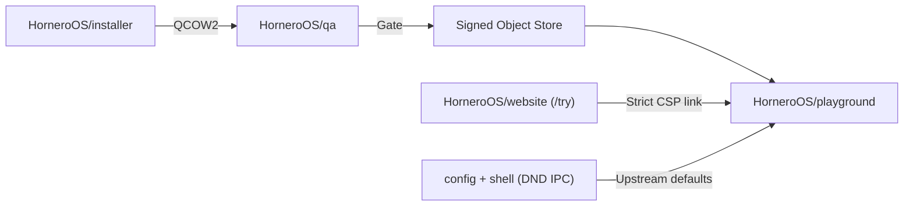

# ADR: Hornero Playground architecture and delivery boundaries

- **Status:** Accepted
- **Date:** 2026-11-28
- **Tracking:** `HorneroOS/playground#1`, `HorneroOS/docs`

## Context

Prospective users, contributors, and reviewers need a zero-friction way to try
HorneroOS without wiping a physical drive or hand-assembling a virtual machine.
At the same time, HorneroOS runs a demanding dual-compositor Wayland stack:
**Hyprland** (`0.57.2-1`, Aquamarine backend) as the validated default, **Niri**
(Smithay backend) as an experimental compositor, **Quickshell** (`0.3.2-1` on
Qt 6) for Hornero Shell, **hornero-greeter** (SDDM / `greetd`), **PipeWire**,
and the V-compiled **`horneroctl`** CLI (`HorneroOS/hornero`).

An ecosystem audit across all `HorneroOS` repositories (`hornero`, `config`,
`shell`, `greeter`, `plugins`, `installer`, `qa`, `docs`, `website`) confirmed
that while HorneroOS already ships a signed preview ISO (`v0.2.0-preview32`),
reproducible lockfiles (`installer/installer.lock.yaml`), and a headless
QEMU/KVM acceptance engine (`qa/src/hornero_qa/engines/native.py`), four gaps
blocked zero-friction adoption:

1. **No user-ready preinstalled VM artifacts or launchers:** `qa` and
   `shell/tests/vm/lib/` build test images strictly for internal CI/offline
   qualification, not downloadable `.qcow2` appliances or 1-command local
   launchers.
2. **No browser-based Wayland + audio demo runtime:** `HorneroOS/website` is a
   static Astro 7 site on Vercel with strict headers (`X-Frame-Options: DENY`,
   `Content-Security-Policy: default-src 'self'; connect-src 'self';
   frame-ancestors 'none'`) and no backend KVM runtime.
3. **No ephemeral multi-tenant session orchestrator or cloud IaC:** Serving live
   KVM sessions safely requires per-visitor CoW overlays, strict TTLs, abuse
   gating, and bare-metal virtualization nodes.
4. **No presenter or demo overlay:** `HorneroOS/config` intentionally forbids
   VM-specific hacks (for example, `tests/test_hyprland_lua.sh` fails if
   `LIBVA_DRIVER_NAME` is added to `environment.lua`), while `shell` exposes
   notification Do Not Disturb via `qs ipc call notifs enableDnd` without a
   dedicated presenter wrapper.

## Options evaluated

### Repository boundary options

| Criterion | Option A: Existing | Option B: `playground` |
| --- | --- | --- |
| `HorneroOS/qa` | Pollutes QA suite | Pure acceptance suite |
| `website` CSP | Weakens static CSP | Astro + strict CSP |
| Cadence | Couples infra/OS | Decoupled infra pins |
| Image reuse | Risk of lock drift | `installer` + `qa` |
| Verdict | **Rejected** | **Selected** |

**Why Option A is rejected:** Placing WebRTC streaming servers, Redis/session
orchestrators, and Terraform IaC inside `HorneroOS/qa` violates `qa`'s
zero-daemon, zero-database architecture (`qa/docs/ARCHITECTURE.md`) and slows
down QA CI. Placing runtime APIs inside `HorneroOS/website` breaks its static
Vercel deployment and security posture.

### Browser execution and streaming comparison

| Stack | Engine | `x86_64` | Audio / UX | Verdict |
| --- | --- | --- | --- | --- |
| **KVM+WebRTC** | KVM VirGL+Opus | **Yes** | PipeWire, 60 FPS | **Selected** |
| **DistroSea** | KVM + `noVNC` | No 3D | Silent, VNC lag | **Discovery** |
| **Selkies** | `pixelflux` | Nested only | `pcmflux` Opus | Portal only |
| **`wayvnc`** | RFB / WebSock | Niri key bugs | Silent, choppy | **Rejected** |
| **Guacamole** | `guacd` Canvas | No (VNC/RDP) | High latency | **Rejected** |
| **KasmVNC** | X11 container | No KVM Wayland | Container only | **Rejected** |
| **SPICE HTML5** | SPICE WebSock | No VirGL 3D | Fragile PCM | **Rejected** |
| **WebVM** | 32b x86 WASM | **No** (no kernel) | N/A | **Rejected** |
| **`copy/v86`** | 32b IA-32 WASM | **No** (32-bit) | N/A | **Rejected** |
| **`v86_64`** | 64b `v86` WASM | **No** (OOM/no 3D) | N/A | **R&D only** |
| **Plasma Web** | `rvwasm` RISC-V | **No** (WASM Qt) | N/A | **Rejected** |
| **JS mock UI** | HTML/CSS/JS | **No** (fake UI) | N/A | **Rejected** |

Detailed evaluation notes:

- **KVM + WebRTC + PipeWire (Selected):** Ephemeral KVM (`virtio-vga-gl` VirGL)
  paired with PipeWire Opus audio and host-side DMA-BUF / `-display dbus`
  capture (covering `hornero-greeter`, Hyprland, and Niri) or in-guest
  `xdg-desktop-portal` + `pipewiresrc` WebRTC delivers ~60 FPS real Wayland.
- **DistroSea (Secondary discovery):** Boots ISOs over `noVNC` with queues and
  session caps, but lacks 3D GPU acceleration and audio, causing blur and
  Chromatic animation lag. Submit via `distrosea.com/contact/` only as an
  organic funnel linking back to the real Playground and VM downloads.
- **Selkies (`selkies-project/selkies` + `pixelflux`):** `pixelflux` runs its
  own Smithay headless compositor (`wayland-1`), replacing DRM/KMS and
  `hornero-greeter` unless compositors are nested inside it.
- **`wayvnc` + `noVNC`, Guacamole, KasmVNC, SPICE HTML5:** `wayvnc` has no
  audio and breaks Niri `Super`/`Alt` bindings; Guacamole requires a VNC/RDP
  bridge; KasmVNC targets X11 containers; `spice-html5` drops VirGL 3D.
- **WebVM (CheerpX), `copy/v86`, Plasma on the Web:** WebVM translates 32-bit
  Linux syscalls without booting a kernel/DRM; `copy/v86` is 32-bit IA-32;
  Plasma on the Web cross-compiles Qt6 to `rvwasm` (`riscv64`) and cannot run
  or validate `x86_64` Arch packages, Hyprland, or Niri.

> **Policy on WebAssembly and UI simulations:** Client-side WebAssembly
> emulation (`portlandhodl/v86_64`) is tracked strictly as an **experimental
> research track**; `wasm32`'s 4 GiB cap, `Memory64` 10%–>100% pointer
> overhead, slow JS/WASM block I/O, and lack of VirGL 3D make it unusable for
> a responsive HorneroOS desktop today. **JavaScript UI simulations** (fake
> browser desktops mimicking Hyprland or Quickshell) are **explicitly
> rejected**: every public Playground experience must boot real HorneroOS
> packages and compositors.

### Local hypervisor & Wayland virtual GPU matrix

| Target | Driver | Config & Caveats | Tier |
| --- | --- | --- | --- |
| **QEMU VirGL** | `virtio-vga-gl` | `renderD*`, `AQ_NO_MODIFIERS` | Primary |
| **QEMU Venus** | `venus=true` | Linux ≥6.13, QEMU ≥9.2, Mesa ≥24.2 | Primary |
| **Quickemu** | `gl="on"` EFI | `horneroos.conf` (4G, 4c, 32G) | Primary |
| **libvirt** | VirtIO 3D | Enable 3D + `virtio` + OVMF | Primary |
| **Software** | `virtio-gpu` | `AQ_*` + `QT_QUICK_BACKEND` | Fallback |
| **VMware** | `vmwgfx` SVGA3D | 3D on; `QSG_RHI_BACKEND=opengl` | Supported |
| **VirtualBox** | `VMSVGA` no 3D | 3D off, 128M VRAM, software | Fallback |
| **macOS UTM** | QEMU **TCG** | `x86_64` on ARM (slow emu) | Fallback |

Wayland and hypervisor compatibility details:

- **VirGL & Venus:** `virtio-vga-gl` (`hostmem=4G,blob=true,gl=on`) gives the
  best virtualized UX; set `AQ_NO_MODIFIERS=1` if DRM modifier negotiation
  fails and `QSG_RHI_BACKEND=opengl` for Qt6/Quickshell. Venus adds
  `blob=true,venus=true` on Linux 6.13+, QEMU 9.2+, Mesa 24.2+, and
  Venus-enabled `virglrenderer`.
- **Software rendering caveat:** Hyprland ≥0.42 (Aquamarine) ignores the legacy
  wlroots variable `WLR_RENDERER_ALLOW_SOFTWARE=1`; use `AQ_DRM_DEVICES`,
  `AQ_NO_KMS_REQUIREMENT`, `AQ_NO_MODIFIERS=1`, `LIBGL_ALWAYS_SOFTWARE=1`,
  `GALLIUM_DRIVER=llvmpipe`, and `QT_QUICK_BACKEND=software` (with `vkms` when
  no DRM node is present).
- **VMware Workstation / Fusion:** Free for personal use; `vmwgfx` is far more
  reliable for Wayland than VirtualBox. Set `QSG_RHI_BACKEND=opengl` or
  `software` if Quickshell hits an EGL/dmabuf black screen.
- **VirtualBox & Apple Silicon UTM:** VirtualBox 3D accel crashes or blanks
  Hyprland/Niri; users must disable 3D, install `virtualbox-guest-utils`, and
  force software rendering. On M1–M4 Macs, `Hypervisor.framework` cannot
  virtualize `x86_64`, so UTM uses QEMU TCG CPU emulation (painfully slow).

### Image generation and artifact distribution

| Approach | Mechanism | Verdict |
| --- | --- | --- |
| **`arch-install-scripts`** | `pacstrap` (`installer.lock`) | **Selected** |
| **Packer** | Blind VNC `boot_command` over ISO | **Rejected** |
| **Kali VM pattern** | `.qcow2.zst`/`.ova` + GPG sums | **Adopted** |

`arch-install-scripts` (`arch-boxes` pattern) loop-mounts a raw image, runs
`pacstrap` from `HorneroOS/installer/installer.lock.yaml`, configures
`hornero-greeter`/users/systemd, and compresses via `qemu-img convert -c -O
qcow2`—avoiding fragile Packer `boot_command` timing. Following Kali's
distribution model, artifacts publish as `.qcow2.zst`/`.7z` and `.ova`/`.vmdk`
with `SHA256SUMS`, GPG `.sig`, explicit credentials, and first-boot docs.

### Cloud KVM hosting economics (verified 2025/2026)

Each interactive HorneroOS session needs **2–4 vCPU threads and 4 GiB RAM**
(capped via systemd cgroups, backed by a shared read-only QCOW2 and an
ephemeral CoW overlay with a 10–15 minute TTL).

| Tier | Specs | Price | Slots | / Slot |
| --- | --- | --- | --- | --- |
| **Hetzner `AX42`** | 8700GE, iGPU, 64G | **€46–€99/mo** | ~8–12 | **€4–€12** |
| **Hetzner `EX44`** | Core i5-13500, 64G | **€59/mo** | ~6–14 | **€4.2–€9.8** |
| **Hetzner `AX52`** | Ryzen 7 7700, 64G | €59–83.7/mo | ~8–12 | **€5–10.5** |
| **GCP `n2-std-16`** | 16 vCPU, 64G L2 | **~$567/mo** | ~8–12 | **$47–$71** |
| **AWS `c7i.metal`** | 96 vCPU, 192G | **$4.28/hr** | ~36–44 | **$71–$87** |

Hetzner bare-metal dedicated nodes (`AX42` with Radeon iGPU + ECC DDR5, `EX44`
with 20 threads and €0 setup) eliminate the L1→L2 nested virtualization tax
and reduce per-slot costs by 6–15× versus GCP nested KVM or AWS `c7i.metal-24xl`
(no small `.metal` instances exist on AWS).

## Decision

HorneroOS adopts **Option B: Dedicated `HorneroOS/playground` repository** for
runtime delivery, local VM launchers, browser streaming, session orchestration,
and cloud IaC, while strictly reusing canonical image generation from
`HorneroOS/installer` and acceptance verification from `HorneroOS/qa`.

### Repository ownership contracts

1. **`HorneroOS/installer` (Canonical Image Producer):** Remains the sole owner
   of OS composition pins (`installer.lock.yaml`, consuming
   `HorneroOS/hornero/editions/catalogue.yaml`). Extending `installer` with
   `scripts/build-vm-image.sh` (following `arch-install-scripts` alongside
   existing `scripts/build-iso.sh`) produces deterministic base QCOW2 images
   without creating a second lockfile or cloning any maintainer's machine.
2. **`HorneroOS/qa` (Acceptance & VM Truth Layer):** Remains the sole owner of
   QEMU/KVM test execution (`NativeEngine`, `qmp.py`, `vision.py`). Every
   published Playground QCOW2 must pass `HorneroOS/qa` acceptance gates
   (`scenarios/playground/`) before promotion. `qa` gains zero daemons, zero
   databases, and zero browser streaming servers.
3. **`HorneroOS/config` & `HorneroOS/shell` (Hardware-Neutral Runtime):** Stay
   clean of VM workarounds. `HorneroOS/config` preserves strict upstream
   desktop invariants (including `tests/test_hyprland_lua.sh`), while
   `HorneroOS/shell` keeps standard IPC such as `qs ipc call notifs enableDnd`
   and Experience Modes.
4. **`HorneroOS/playground` (Delivery & Runtime Plane):** Owns all
   Playground-specific code:
   - **VM overlay & presenter layer:** Ephemeral `systemd-detect-virt` graphics
     hooks (`AQ_NO_MODIFIERS=1`, `QSG_RHI_BACKEND=opengl`, VirtualBox software
     fallback) and `hornero-presenter` wrapper driving shell DND IPC and
     screen-idle inhibit.
   - **Local VM launchers:** Standalone `hornero-vm-run.sh` (QEMU/KVM VirGL),
     Quickemu `horneroos.conf` (plus upstream `quickget` metadata), libvirt XML
     guidance, and `.ova`/`.vmdk` packaging scripts.
   - **Browser streaming stack:** VirGL KVM worker + PipeWire audio + WebRTC
     bridge (host-side DMA-BUF / `-display dbus` capture covering
     `hornero-greeter`, Hyprland, and Niri, or in-guest `pipewiresrc` portal
     capture).
   - **Ephemeral session orchestrator & Terraform IaC:** Per-session CoW
     overlays, 15-minute hard TTL reaper, Turnstile/rate limiting, and
     bare-metal node provisioning (Hetzner `AX42`/`EX44`).
   - **External artifact storage:** Hosts compressed `.qcow2.zst` / `.ova`
     images (>2 GB, avoiding GitHub's 2 GB release asset cap) alongside
     `SHA256SUMS` and detached GPG `.sig` files.
5. **`HorneroOS/website` & `HorneroOS/docs`:** `website` stays static on
   Vercel and adds `/try` linking cleanly to `playground` downloads and hosted
   endpoints without weakening `website/vercel.json`'s CSP. `docs` maintains
   the bilingual user guide ([Try HorneroOS](../getting-started/try-horneroos.md))
   and security architecture.

### Rollout phases

- **Phase 1 (Zero-Infra Local Adoption):** Ship `scripts/build-vm-image.sh`
  integration from `installer.lock.yaml`, `HorneroOS/qa` `scenarios/playground/`
  gating, signed `.qcow2.zst` downloads, `hornero-vm-run.sh`, Quickemu
  `horneroos.conf`, `hornero-presenter`, bilingual `try-horneroos.md` guides,
  and the static `https://www.horneroos.com/try` page, plus DistroSea
  submission as a secondary discovery listing.
- **Phase 2 (Flagship Browser Playground):** Deploy the ephemeral KVM, WebRTC,
  and PipeWire orchestrator plus Terraform IaC on Hetzner bare metal, gated by
  the [Hornero Playground threat model](hornero-playground-threat-model.md).

## Consequences

### Positive

- Preserves strict separation of concerns across `installer`, `qa`, `config`,
  `shell`, `website`, and `playground` with zero HorneroOS forks.
- Every browser session and local VM runs authentic HorneroOS packages and
  Wayland compositors rather than mocked web UIs.
- Keeps infrastructure costs predictable (~€46–€59/mo starter node) and allows
  Phase 1 local VMs to ship immediately with zero server maintenance.

### Negative and honest boundaries

- Adds a dedicated repository (`HorneroOS/playground`) and external object
  storage pipeline for >2 GB VM artifacts, mirroring the existing Vercel Blob
  handling used by `v0.2.0-preview32` (2.7 GB ISO).
- **Shipped truth boundaries remain enforced:** Current released ISOs up to
  `v0.2.0-preview32` have VM validation only (no physical-hardware
  certification); `Desktop`, `Studio`, and `Gaming` are `preview` editions;
  `Niri` is `experimental`; `Server` and `Agents` are `planned`; full OS root
  rollback is not yet shipped (`snapshot_backend_name` is `none`); and
  `Hornero Apps` / 3-mode `Hornero Welcome` changes on `main` only reach ISO/VM
  users when new locked artifacts are built.
- VirtualBox (`VMSVGA` without 3D) and macOS Apple Silicon UTM (`x86_64` TCG)
  remain degraded software/emulated paths with documented caveats rather than
  native-speed experiences.

## References

- [Hornero Playground threat model](hornero-playground-threat-model.md)
- [Try HorneroOS without installing](../getting-started/try-horneroos.md)
- [Architecture overview](README.md)
- [Editions and package composition](editions.md)
- [Security and privacy](../security/README.md)
