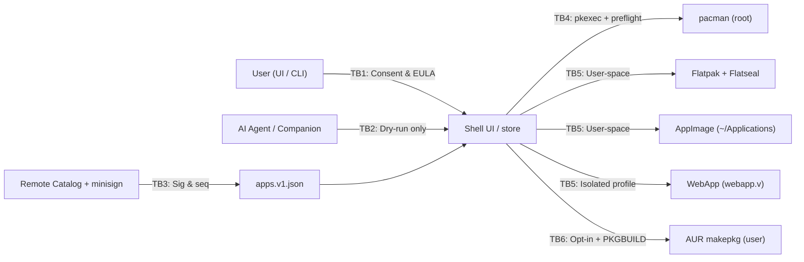

# Hornero Apps security threat model and supply-chain policy

- **Status:** Accepted
- **Date:** 2026-11-28
- **Tracking:** `HorneroOS/docs#166`, `HorneroOS/hornero#506`
- **Methodology:** Microsoft STRIDE + Software Supply Chain + Agentic Controls

## Scope, assets, actors, and trust boundaries

Hornero Apps orchestrates software discovery and installation across
Quickshell (`HorneroOS/shell`), `horneroctl store` (`HorneroOS/hornero`), and
the declarative catalog (`catalog/apps.v1.json`).

### Protected assets

1. Host root filesystem (`/`, `/usr`, `/etc`, `/var/lib/pacman`) and system
   integrity.
2. User home directory, SSH/GPG/cloud credentials (`~/.ssh`, `~/.gnupg`,
   `~/.aws`), and browser session cookies.
3. Software trust policy configuration, declarative manifests, and append-only
   audit trail (`audit.jsonl`).
4. Cryptographic keys (`hornero-release.pub.asc`, catalog `minisign` public
   key, pacman keyring).

### Actors and trust boundaries

- **TB1 (User consent):** Separates unconfirmed intents from state-changing
  transactions (`--yes` or UI confirmation).
- **TB2 (Agent boundary):** AI assistants and Companion cannot approve
  installs, accept EULAs, or cross TB1/TB4.
- **TB3 (Catalog integrity):** Untrusted network mirror vs verified signed
  catalog (`minisign`).
- **TB4 (Privilege boundary):** Unprivileged user session vs root `pacman`
  transaction via `pkexec` (`polkit-gnome`).
- **TB5 (User-space runtimes):** Sandboxed Flatpak vs unsandboxed AppImage vs
  isolated browser WebApp profiles.
- **TB6 (Community build scripts):** Unreviewed AUR `PKGBUILD` recipes vs
  user inspection and non-root `makepkg`.

## Core security controls

### 1. Compromised catalog entry containment

`catalog/apps.v1.json` is strictly declarative data, never executable code.
`horneroctl store` maps schema fields (`arch_pkg`, `flathub_id`,
`appimage_url`, `webapp_url`) to allowlisted argv builders without shell
interpolation (`sh -c`). Identifiers are validated with strict character
allowlists (extending `validate_app_id` in `webapp.v`). Even if an attacker
modifies a catalog field, the catalog cannot inject arbitrary shell flags,
arbitrary `Exec=` lines, or root commands.

### 2. Polkit privilege separation

Neither the Quickshell UI nor `horneroctl store` runs as `root`. Privileged
operations are restricted to bounded `pacman` transactions launched through
`pkexec` (`polkit-gnome`), prompting the user interactively. Flatpak user
installs, AppImage downloads, Gear Lever integration, and WebApp `.desktop`
creation never request Polkit elevation.

### 3. Pacman lock and partial-upgrade prevention

Before invoking `pkexec pacman`, `horneroctl store` runs the preflight checks
from `package_safety.v`:

- Refuses to start when `/var/lib/pacman/db.lck` exists (never deletes an
  active lock).
- Checks free disk space on `/` (blocks below 512 MiB, warns below 2 GiB).
- Blocks non-interactive root elevation without a valid Polkit/TTY context.
- Enforces full-system sync (`-Syu`) whenever repository databases refresh,
  eliminating `pacman -Sy <pkg>` partial-upgrade breakage.

### 4. AUR non-root build and PKGBUILD review gate

AUR integration is disabled by default. When explicitly enabled by the user:

- Entries are tagged `community_package` and never promoted to `Official`.
- `horneroctl store` fetches and displays the `PKGBUILD` and `.SRCINFO`
  diff/source for explicit human review before any build runs.
- Builds run strictly non-root via `makepkg` (never `sudo makepkg`).
- Chaotic-AUR and unverified third-party binary repos are excluded from
  factory defaults.

### 5. AppImage non-root lifecycle and honest disclosure

AppImages are stored in user space (`~/Applications`), verified against
catalog-pinned SHA-256 checksums whenever upstream publishes them, and
registered via Gear Lever (`it.mijorus.gearlever`) without root access.
Hornero Apps explicitly labels AppImages as **unsandboxed user executables**:
unlike Flatpak, an AppImage has full read/write access to your user session
and files.

### 6. WebApp credential and profile isolation

Extending `cli/modules/hornero_core/webapp.v`, every Hornero WebApp passes
`validate_app_id` (blocking `/`, `\`, `..`, NUL, newlines, and leading `.` or
`-`) and validates `http://` or `https://` URLs. Each WebApp launches with an
isolated `--user-data-dir` under XDG state/data rather than sharing the
user's primary browser profile. Session cookies, localStorage tokens, and
site permissions for one SaaS app cannot leak to other sites or hijack the
user's default browser profile.

### 7. Remote catalog signature and rollback protection

Remote catalog updates (`catalog/apps.v1.json`) ship with a detached
`minisign` signature verified against HorneroOS's pinned public key before
replacing the local cache. Signed catalog metadata enforces:

- **Monotonic sequence version (`catalog_seq`):** Rejects updates whose
  sequence number is lower than the locally accepted catalog, preventing
  rollback to older manifests containing vulnerable or revoked packages.
- **Timestamp and freshness window (`generated_at` / `expires_at`):** Flags
  expired catalogs so a network attacker cannot freeze stale security metadata
  indefinitely.

### 8. Proprietary trademark and redistribution boundaries

HorneroOS never mirrors, bundles, or repackages proprietary binaries or
protected trademarks (such as ChatGPT Desktop, Claude Desktop, Cursor, Steam,
REAPER, or ArtCraft). Catalog entries point strictly to upstream vendor URLs
or signed vendor repositories, display the exact upstream license class, and
require explicit user opt-in before installing proprietary software.

### 9. AI agent and Companion policy enforcement

AI assistants (`horneroctl assistant`, `horneroctl agent`) and the Shell
Companion operate under strict non-delegable consent rules aligned with
`horneroctl assistant policy`:

- Agents cannot execute `horneroctl store install`, `remove`, `update`,
  `policy`, or `sources` mutations unattended.
- Agents cannot elevate via Polkit, weaken Flatpak permissions, enable AUR, or
  accept proprietary EULAs/licenses on the user's behalf.
- Agents may run read-only discovery (`search`, `show`, `list`, `doctor`) or
  stage a `--dry-run` proposal that queues an action for explicit human review
  and `--yes` or UI click confirmation.

## STRIDE and supply-chain risk matrix

| ID | Asset / TB | STRIDE | Severity | Primary control |
| --- | --- | --- | --- | --- |
| T1 | Catalog / TB3 | T, E | Critical | `minisign` verify + typed allowlist |
| T2 | Catalog / TB3 | T, R | High | Monotonic `catalog_seq` + `expires_at` |
| T3 | Host OS / TB4 | E, D | High | Direct `pkexec pacman -Syu` + preflight |
| T4 | Session / TB6 | T, E | High | Opt-in AUR + `PKGBUILD` review |
| T5 | User / TB5 | I, E | High | User-space, SHA-256, unsandboxed |
| T6 | Browser / TB5 | I, S | Medium | Per-app `--user-data-dir` + `webapp.v` |
| T7 | AI agent / TB2 | S, E, R | High | Agents denied mutations + EULA |
| T8 | Policy / TB1 | R, T | Medium | `store policy` gates + `audit.jsonl` |

### Threat details and acceptance criteria

- **T1 (Tampered catalog entry):** Attackers modify `catalog/apps.v1.json`
  on a mirror to inject shell metacharacters. Mitigated by `minisign`
  verification and shell-free argv dispatch. Acceptance criterion: tampered
  signatures and invalid IDs fail before execution.
- **T2 (Catalog rollback or freeze):** Attackers replay an older signed
  catalog to conceal revoked packages. Mitigated by monotonic `catalog_seq`
  and `expires_at` expiry checks. Acceptance criterion: `horneroctl store
  update` rejects older sequence numbers.
- **T3 (Partial upgrade or lock corruption):** Stale sync DBs or forced
  `db.lck` removal break system libraries. Mitigated by dropping PackageKit
  and running `package_safety.v` preflight. Acceptance criterion: active
  `db.lck` or low disk space blocks transactions cleanly.
- **T4 (Malicious AUR recipe):** Hostile `PKGBUILD` runs code during build.
  Mitigated by keeping AUR off by default, displaying `PKGBUILD`, and
  running non-root `makepkg`. Acceptance criterion: unreviewed or root AUR
  builds are refused.
- **T5 (Malicious or spoofed AppImage):** Altered AppImage runs with full
  user privileges. Mitigated by user-space placement, SHA-256 check when
  pinned, and explicit non-sandbox UI disclosure. Acceptance criterion:
  checksum mismatch aborts before executable permission is set.
- **T6 (WebApp credential leakage or injection):** WebApp shares primary
  cookies or injects `.desktop` keys. Mitigated by per-app `--user-data-dir`
  and `validate_app_id`. Acceptance criterion: disjoint cookie storage and
  unit-tested ID rejection.
- **T7 (Prompt-injected agent or Companion):** Prompt injection attempts
  unattended installs or EULA acceptance. Mitigated by restricting agents to
  read-only queries and `--dry-run` proposals. Acceptance criterion: agent
  calls to `install --yes` are denied and logged.
- **T8 (Unauthorized source or missing audit trail):** Unverified apps enter
  managed workstations without record. Mitigated by `horneroctl store
  policy` and append-only `audit.jsonl`. Acceptance criterion: disallowed
  sources fail policy checks and every mutation appends a JSONL event.

## Residual risks and honest boundaries

- **Upstream account compromise:** If an upstream vendor's own release server
  or signing key is compromised, `vendor_official_repo` or
  `flathub_verified` verification passes until upstream revokes the release.
- **Unsandboxed native and AppImage software:** Native Arch packages and
  AppImages run without Flatpak container confinement once executed; users
  requiring app-level sandboxing should prefer `flathub_verified` builds and
  review permissions with Flatseal.
- **No OS-level rollback:** Because `snapshot_backend_name` is `none`,
  failed or unwanted native `pacman` installs cannot be automatically rolled
  back at the filesystem level today.

## References

- [ADR: Hornero Apps architecture](adr-hornero-apps.md)
- [Security and privacy](../security/README.md)
- [Updates and recovery](../desktop/updates-and-rollback.md)
- [Hornero Apps user guide](../desktop/hornero-apps.md)
