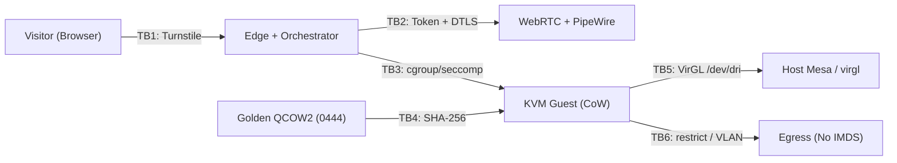

# Hornero Playground security threat model and operations runbook

- **Status:** Accepted
- **Date:** 2026-11-28
- **Tracking:** `HorneroOS/playground#1`, `HorneroOS/docs`
- **Methodology:** STRIDE + Ephemeral KVM + Supply-Chain Controls

## Scope, assets, actors, and trust boundaries

Hornero Playground delivers HorneroOS in two execution modes defined in the
[Hornero Playground ADR](adr-hornero-playground.md):

1. **Hosted Browser Playground:** Multi-tenant ephemeral KVM virtual machines
   streamed over WebRTC (video + PipeWire audio) from dedicated bare-metal
   nodes managed by `HorneroOS/playground`.
2. **Local VM Appliances & Launchers:** Signed `.qcow2.zst` / `.ova` images
   and launcher wrappers (`hornero-vm-run.sh`, Quickemu `horneroos.conf`) run
   by users on their own hardware.

### Protected assets

1. **Bare-metal host kernel, `/dev/kvm`, and host GPU render nodes**
   (`/dev/dri/renderD*` used for VirGL).
2. **Orchestrator control plane, TURN secrets, and release signing keys**
   (`hornero-release.pub.asc` / private release GPG key, TLS/DTLS keys).
3. **Golden read-only base QCOW2 images** and `installer.lock.yaml` integrity.
4. **Co-resident tenant isolation** (adjacent ephemeral VMs on the same host).
5. **Host network reputation and internal infrastructure** (preventing SSRF to
   IMDS, RFC1918 pivoting, SMTP spam, DDoS amplification, and crypto-mining).
6. **Public static `HorneroOS/website` origin** and **visitor browsers**.

### Actors and trust boundaries

- **TB1 (Public ingress & abuse gate):** Untrusted internet traffic vs
  Turnstile verification, per-IP/ASN rate limits, and slot allocator.
- **TB2 (Stream & session boundary):** Visitor browser vs signaling WebSocket,
  ephemeral bearer token, and DTLS-SRTP WebRTC media channel.
- **TB3 (Hypervisor & resource boundary):** Untrusted guest OS/root inside the
  VM vs host Linux kernel, QEMU user-space process, and cgroup limits.
- **TB4 (Image integrity & persistence boundary):** Immutable golden QCOW2 and
  signed release pipeline vs ephemeral session copy-on-write (CoW) disk.
- **TB5 (Paravirtualized GPU boundary):** Guest Mesa/DRM commands vs host
  `virglrenderer` and `/dev/dri/renderD*` shader/command-buffer parser.
- **TB6 (Guest network egress boundary):** Guest networking vs host management
  network, cloud metadata, and external abuse targets.

## Core security controls

### 1. VM escape and hypervisor hardening

Every hosted Playground session runs inside a hardware-isolated KVM guest
modeled on `HorneroOS/qa`'s `NativeEngine` constraints, hardened for untrusted
public tenants:

- **Hardware virtualization without nested KVM:** Launch `qemu-system-x86_64`
  with `-enable-kvm -machine q35` and explicitly disable nested virtualization
  flags (`vmx=off` / `svm=off`) so guests cannot spawn L2 hypervisors.
- **Unprivileged QEMU + seccomp:** Each VM runs under an isolated non-root
  service UID (never `root`) with QEMU sandboxing enabled (`-sandbox
  on,obsolete=deny,elevateprivileges=deny,spawn=deny,resourcecontrol=deny`),
  dropped Linux capabilities, and `NoNewPrivileges=yes`.
- **Deterministic cgroup budgets:** Wrap each worker in a dedicated systemd
  scope enforcing `MemoryMax` (4 GiB guest RAM + 1.2 GiB VirGL host overhead),
  `MemorySwapMax=0`, `CPUQuota`, `TasksMax`, and a hard maximum CoW overlay
  size so a guest fork-bomb or disk-fill attack cannot starve neighbors.
- **Read-only golden QCOW2 + ephemeral CoW overlay:** The golden base QCOW2
  is mounted read-only (`0444`, verified by SHA-256 at worker boot). Each
  session receives an isolated overlay (`qemu-img create -f qcow2 -F qcow2 -b
  <golden> <overlay>`) deleted immediately when the session ends or times out.
- **VirGL surface minimization:** Because `virtio-vga-gl` routes guest OpenGL
  calls through host `virglrenderer` and Mesa, bare-metal nodes track current
  patched `qemu`, `virglrenderer`, and `mesa` packages, block unauthenticated
  QMP/SSH/monitor sockets, and disable `virtio-fs` / `9p` host file sharing.

### 2. Network and abuse containment

Publicly reachable Linux VMs are prime targets for spam, credential stuffing,
crypto-mining, and internal network pivoting. Playground enforces two strict
network modes:

- **Restricted Showcase Mode (default for anonymous browser sessions):** Boots
  with QEMU user-mode networking `restrict=on` (or an isolated zero-egress
  bridge), allowing visitors to test Hyprland, Niri, Hornero Shell, Welcome,
  the offline app catalog preview, and `horneroctl` with **zero internet
  egress**.
- **Controlled Egress Mode (opt-in tier if online demos are enabled):** Places
  each VM on an isolated egress VLAN enforced by host `nftables` rules that:
  - Drop all traffic to RFC1918 (`10.0.0.0/8`, `172.16.0.0/12`,
    `192.168.0.0/16`), loopback, link-local (`169.254.0.0/16`), CGNAT
    (`100.64.0.0/10`), cloud IMDS (`169.254.169.254`), and IPv6
    `fe80::/10` / `fd00::/8`.
  - Block outbound SMTP (`25`, `465`, `587`), common mining stratum ports,
    BitTorrent/P2P, and outbound raw port-scanning bursts.
  - Shape per-VM egress bandwidth and enforce strict DNS filtering.
- **Abuse gates and hard TTLs:**
  - Every allocation request requires a valid **Cloudflare Turnstile** token
    and passes per-IP / per-subnet concurrency and daily quota checks.
  - Sessions enforce a **15-minute hard maximum TTL** plus a **5-minute idle
    timeout**, enforced by an out-of-band host reaper that terminates the
    systemd scope and deletes the CoW overlay regardless of guest state.

### 3. Session, stream, and credential isolation

- **Ephemeral session bearer tokens:** Each allocated VM mints a >=256-bit
  cryptographically random session token scoped strictly to that single VM UUID
  and WebRTC room, expiring immediately upon teardown.
- **Encrypted transport:** Signaling runs exclusively over HTTPS/WSS (TLS 1.3),
  WebRTC media and input DataChannels require DTLS-SRTP, and TURN relay
  credentials use short-lived HMAC-signed `coturn` leases.
- **Isolated PipeWire and zero shared clipboard/storage:** Audio capture binds
  to a per-session PipeWire node/sink so sound never leaks across tenants.
  Host-side clipboard sharing is disabled by default; any explicit paste helper
  uses a size-capped, plain-text-only DataChannel message.
- **Zero persistent user credentials:** Playground VMs boot an unprivileged
  ephemeral demo user (`hornero` / `hornero`) with zero SSH keys, zero API
  tokens, and zero persistent home directory. The browser UI warns visitors
  never to enter personal passwords or secrets into a public session.
- **Static website isolation:** `HorneroOS/website` retains its strict Vercel
  CSP (`default-src 'self'; connect-src 'self'; frame-ancestors 'none'`). The
  hosted Playground runs on a separate origin (`playground.horneroos.com`) with
  strict origin-scoped CORS and `frame-ancestors 'self'`.

### 4. Artifact supply chain (golden images and local VMs)

- **Reproducible builds from lockfile:** Both hosted golden QCOW2 images and
  downloadable local VM images are built cleanly via `arch-install-scripts`
  (`pacstrap`) consuming `HorneroOS/installer/installer.lock.yaml` and
  `HorneroOS/hornero/editions/catalogue.yaml`—never by snapshotting or cloning
  a maintainer's personal workstation.
- **Cryptographic verification:** Published `.qcow2.zst`, `.ova`, and `.iso`
  files ship with `SHA256SUMS` and detached GPG `.sig` signatures signed by
  the HorneroOS releases key (`FCFBEE43925AB5429362278AE59EAB44AA2498DC`,
  `packaging/keys/hornero-release.pub.asc` in `HorneroOS/hornero`).
- **Pre-promotion QA gate:** Every candidate VM image must pass
  `HorneroOS/qa` acceptance scenarios (`scenarios/playground/`) before
  entering object storage or live bare-metal pools.

## STRIDE risk matrix and acceptance criteria

| ID | Asset / TB | STRIDE | Severity | Primary control |
| --- | --- | --- | --- | --- |
| T1 | Host / TB3, TB5 | E | Critical | Non-root KVM, seccomp, VirGL |
| T2 | Host / TB3 | D | High | `MemoryMax`, `CPUQuota`, cap |
| T3 | Tenant / TB4 | I | High | `0444` QCOW2, CoW wipe |
| T4 | Net / TB6 | E, T | Critical | `restrict=on` / drop IMDS |
| T5 | Slots / TB1 | D | High | Turnstile, IP cap, 15m TTL |
| T6 | Stream / TB2 | S, I, T | High | 256b token, WSS + DTLS-SRTP |
| T7 | Audio / TB2 | I | Medium | Per-VM PipeWire, no clip |
| T8 | Image / TB4 | T | Critical | Lockfile, SHA-256, GPG sig |
| T9 | Site CSP / TB2 | T, I | Medium | Separate Playground origin |
| T10 | Secrets / TB2 | I | Medium | Ephemeral user, UI warning |

### Threat details and verifiable acceptance criteria

- **T1 (Hypervisor or VirGL escape):** A malicious guest binary exploits QEMU
  or `virglrenderer`. Mitigated by unprivileged per-VM UIDs, QEMU seccomp
  sandboxing, disabled nested KVM, no `virtio-fs`, and timely Mesa/QEMU
  updates. *Acceptance criterion:* `qemu-system-x86_64` runs non-root with
  `NoNewPrivileges=yes`, `virglrenderer` CVE check passes in CI/ops, and no QMP
  or SSH socket is reachable from guest or public interfaces.
- **T2 (CPU, RAM, or disk exhaustion DoS):** A guest triggers an OOM, fork
  bomb, or fills the virtual disk. Mitigated by systemd scope `MemoryMax`,
  `MemorySwapMax=0`, `CPUQuota`, `TasksMax`, and capped sparse CoW files.
  *Acceptance criterion:* Stressing guest RAM/PIDs terminates only the
  offending VM scope without affecting co-resident slots or host SSH/control
  processes.
- **T3 (Cross-session data persistence):** Visitor A leaves files or shell
  history seen by Visitor B. Mitigated by read-only `0444` golden QCOW2 and
  forced deletion of the CoW overlay on exit. *Acceptance criterion:* Starting
  two consecutive sessions verifies identical golden QCOW2 SHA-256 and a fresh
  overlay with zero files from session A.
- **T4 (SSRF, IMDS access, or outbound abuse):** Guest probes `169.254.169.254`,
  LAN hosts, or sends spam/mining traffic. Mitigated by `restrict=on` default
  and `nftables` egress drops on any online tier. *Acceptance criterion:*
  Automated smoke test inside guest confirms connections to RFC1918, IMDS,
  and TCP/25 fail immediately.
- **T5 (Botnet slot exhaustion):** Automated scripts exhaust all available VM
  slots. Mitigated by Turnstile verification, per-IP/subnet concurrency caps,
  and a 15-minute out-of-band reaper. *Acceptance criterion:* Unauthenticated
  or duplicate-IP allocation requests receive HTTP 403/429 and no VM stays
  alive past `TTL + 15s`.
- **T6 (Stream hijacking or eavesdropping):** Attacker guesses a room ID or
  sniffs WebRTC media. Mitigated by 256-bit CSPRNG single-session tokens, TLS
  1.3 signaling, and mandatory DTLS-SRTP. *Acceptance criterion:* Joining a
  session with an expired or mismatched token fails signaling handshake;
  unencrypted RTP is rejected.
- **T7 (Cross-tenant audio or clipboard leak):** Audio or clipboard crosses
  between VMs or host. Mitigated by per-VM PipeWire sinks and disabled host
  clipboard sync. *Acceptance criterion:* Concurrent sessions produce disjoint
  PipeWire sink IDs and host clipboard contents are never readable inside VMs.
- **T8 (Supply-chain tampering on golden or local VM images):** Attacker alters
  a downloadable `.qcow2.zst` or golden image. Mitigated by deterministic
  `installer.lock.yaml` builds, `qa` acceptance gating, `SHA256SUMS`, and GPG
  `.sig`. *Acceptance criterion:* Tampered image fails `gpg --verify` and
  `sha256sum -c` before boot or download promotion.
- **T9 (Static website CSP degradation):** Embedding streaming sockets weakens
  `horneroos.com` headers. Mitigated by origin isolation on
  `playground.horneroos.com`. *Acceptance criterion:* `website/vercel.json`
  keeps `default-src 'self'; connect-src 'self'; frame-ancestors 'none'`.
- **T10 (Visitor enters personal credentials):** User signs into GitHub or
  email inside a public demo VM. Mitigated by explicit pre-session and banner
  warnings plus immediate overlay wipe on exit. *Acceptance criterion:*
  Session start banner and `try-horneroos` docs explicitly warn against
  entering real credentials, and exit destroys the overlay.

## Operational incident response runbook

When monitoring or a security report flags anomalous host behavior (unexpected
CPU saturation, `nftables` drop bursts, repeated QEMU/VirGL crashes, or abuse
notifications):

1. **Triage and isolate (0–5 minutes):**
   - Inspect active systemd VM scopes, per-IP allocation logs, and `nftables`
     egress counters on the affected bare-metal node.
   - If active abuse or a suspected hypervisor bug is observed, **enable the
     orchestrator maintenance drain** (blocks new Turnstile allocations) or
     apply the emergency `nftables` egress block on the node.
2. **Terminate and preserve forensics (5–15 minutes):**
   - Terminate offending VM scopes via the orchestrator reaper while keeping
     host `journald`, `nftables`, and orchestrator audit logs (never expose
     tenant keystrokes or PII publicly).
   - If a VirGL or QEMU escape is suspected, cordon the entire bare-metal
     node from production DNS/load-balancing immediately.
3. **Remediate and patch:**
   - Apply upstream kernel, QEMU, `virglrenderer`, or Mesa security updates,
     rebuild golden QCOW2 images from an updated `installer.lock.yaml` if guest
     packages are implicated, and re-run `HorneroOS/qa` `scenarios/playground/`
     before returning the node to service.
4. **Coordinate disclosure:**
   - Report or track security vulnerabilities privately via
     [`SECURITY.md`](https://github.com/HorneroOS/.github/blob/main/SECURITY.md)
     or GitHub Private Vulnerability Reporting—never in public issues.

## Residual risks and honest boundaries

- **Shared-kernel / VirGL surface:** Hardware-accelerated `virtio-vga-gl`
  exposes host Mesa and `virglrenderer` to guest shader/command streams, which
  is a larger attack surface than software-only `virtio-gpu`. If a critical
  VirGL CVE has no host patch available, operators must fall back to software
  rendering or pause the hosted tier until patched.
- **Local VM user responsibility:** Once a user downloads a `.qcow2.zst` or
  ISO to their own machine, host firewalling, disk encryption, and hypervisor
  patching belong to the user's host OS.
- **No full OS rollback inside guests:** Inside any local VM or installed
  system, `horneroctl recovery doctor` is read-only and native `pacman`
  installs lack automatic OS-root rollback (`snapshot_backend_name` is
  `none`; see [Updates and recovery](../desktop/updates-and-rollback.md)).

## References

- [ADR: Hornero Playground architecture](adr-hornero-playground.md)
- [Try HorneroOS without installing](../getting-started/try-horneroos.md)
- [Security and privacy](../security/README.md)
- [Hornero Apps threat model](hornero-apps-threat-model.md)
