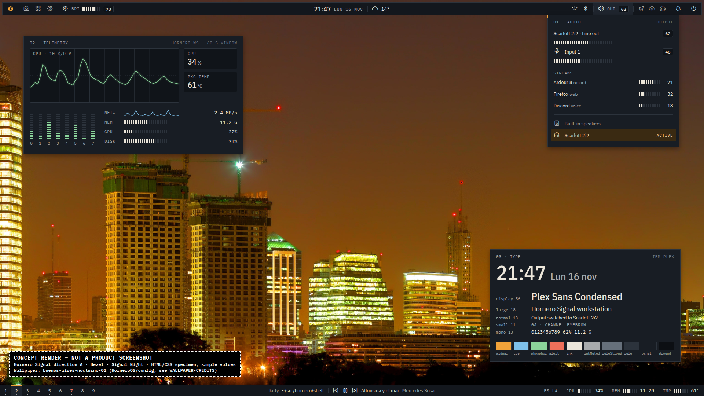
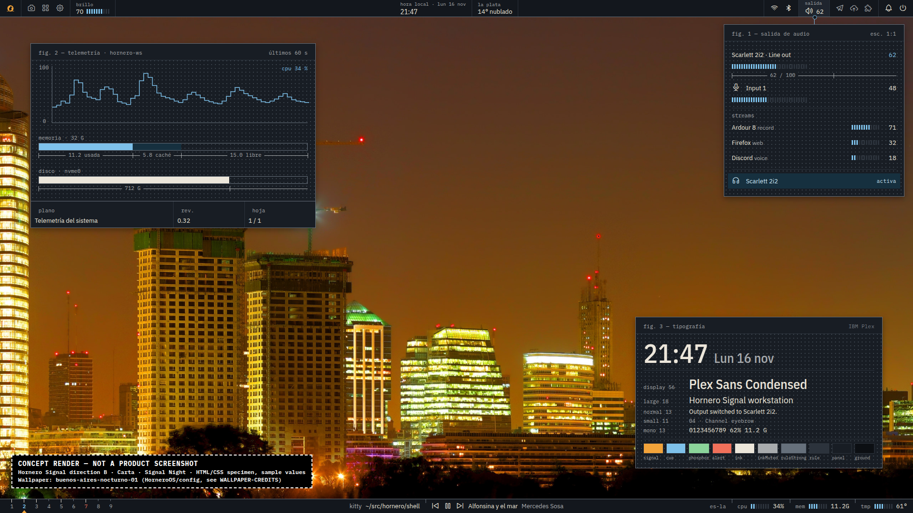
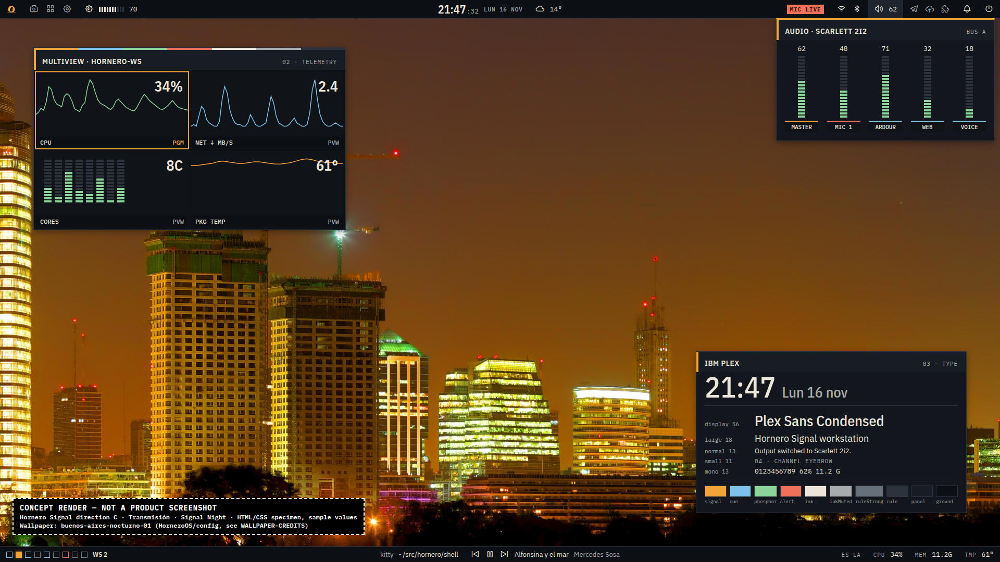
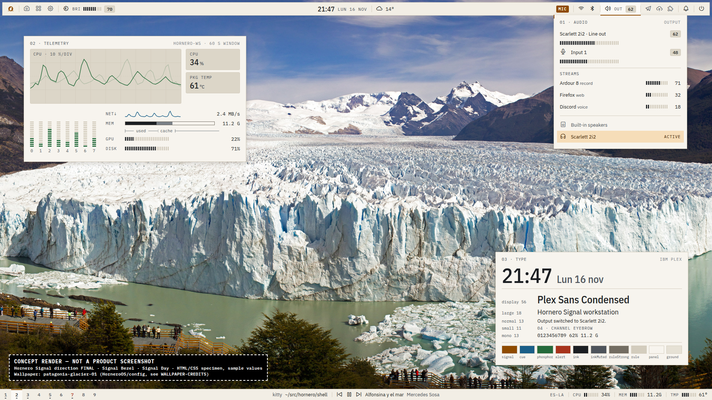
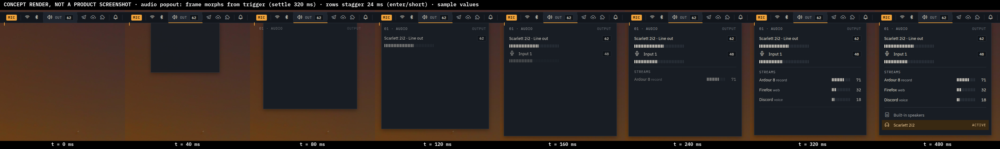
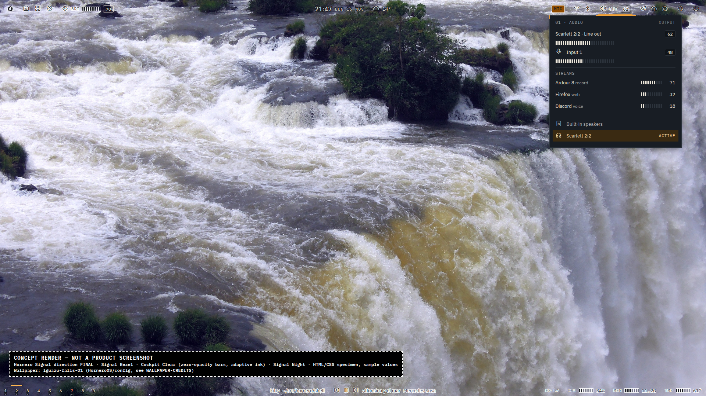
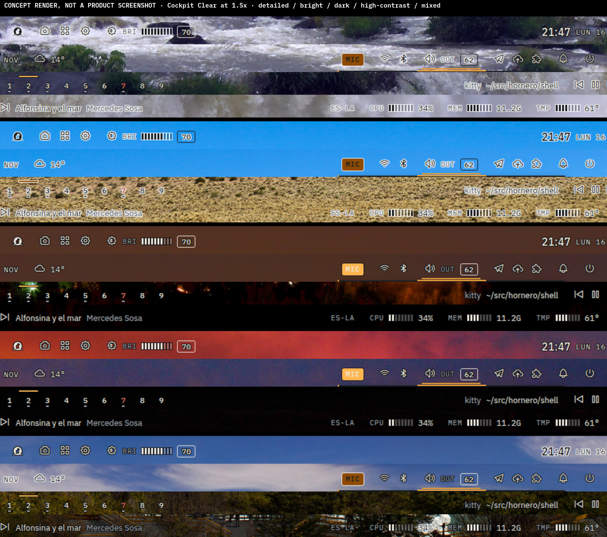

# Signal Visual Language

- **Status** — Accepted direction (2026-11-16) for
  [RFC 0001 — Hornero Signal](rfc-0001-hornero-signal.md), amendment 1
- **Tracking** —
  [HorneroOS/.github#28](https://github.com/HorneroOS/.github/issues/28)
- **Audience** — QML engineers (shell, PluginKit, extensions), theme and
  brand contributors, reviewers

This document turns the RFC's creative direction into concrete rules: bar
anatomy, workspace indicator, meters, panel framing, states, luminous and
phosphor details, motion choreography, Cockpit Clear and the art direction of
every layout preset. The RFC stays authoritative for token names, font
families, the glyph API, motion names and the anchored-surface contract. This
document only uses those contracts; where it proposes a change it says so and
the change needs an RFC amendment first.

> **Every image in this document is a concept render**, built as an HTML/CSS
> specimen and rendered headlessly with Playwright at 1920×1080. They are not
> product screenshots and show sample values, not live telemetry. Each image
> carries a "CONCEPT RENDER" label. Product evidence comes from host captures
> under RFC §7.1.

## 1. Research basis

Seven observations shaped the rules below. Designs were studied for their
principles, not copied.

1. **Strong desktops show little and type it well.** Minimal Rainmeter skins
   centre on a clock, date and a few system readouts, keep a monochrome
   palette that adapts to the wallpaper and prune modules aggressively
   ([overview](https://www.rankred.com/rainmeter-skins/)). The long-lived
   Conky ring scripts (londonali1010's *Rings*, SeaJey's *Seamod*) work
   because every ring is labelled and shares one accent
   ([Rings](https://www.deviantart.com/londonali1010/art/Rings-Meters-for-Conky-141961783),
   [Seamod](https://art.cleberg.net/post/seajey/Conky-Seamod-v0-1-283461046)).
2. **Purposeful bars encode workspace state, not decoration.** Waybar's
   workspace modules expose distinct active, visible, empty and urgent states
   as styling hooks
   ([waybar-sway-workspaces(5)](https://man.archlinux.org/man/extra/waybar/waybar-sway-workspaces.5.en),
   [Waybar configuration](https://github.com/Alexays/Waybar/wiki/Configuration)).
   The best configurations give each state its own visible treatment that
   does not rely on colour alone.
3. **Fictional UI is grounded in real engineering, but optimised for an
   audience.** Territory Studio researches real military and industrial
   screens before inventing film interfaces, and says the goal of screen
   graphics is to explain information at a glance to a viewer
   ([Pushing Pixels interview](https://www.pushing-pixels.org/2014/08/07/the-craft-of-screen-graphics-and-movie-user-interfaces-interview-with-david-sheldon-hicks-of-territory-studio.html)).
   We take the grounding (graticules, channel labels, segment meters) and
   reject the density, because an operator uses this for hours.
4. **Cyberpunk 2077 shows what to avoid as well as what to keep.** A detailed
   critique notes decorative elements sharing the functional red, a
   monochrome map that cannot separate zones, tabs that move and break
   spatial memory, and attention-grabbing animated markers; it praises
   contextual HUD elements that appear only when relevant
   ([Interface In Game](https://interfaceingame.com/articles/cyberpunk-2077-ux-ui-critique),
   [GDC 2023 talk](https://gdcvault.com/play/1034160/User-Interface-in-Cyberpunk-2077)).
5. **Too many type treatments per screen reads as noise.** Bungie's
   *Marathon* "graphic realism" UI was criticised as "fontslop": too many
   fonts, weights, sizes and spacings on one page
   ([Creative Bloq](https://www.creativebloq.com/3d/video-game-design/bungies-art-director-explains-marathons-controversial-art-style),
   [PC Gamer](https://www.pcgamer.com/games/fps/marathon-ui-designer-declares-himself-the-fontslop-merchant-and-promises-bungie-will-never-remove-the-sauce-from-the-ui)).
6. **A period constraint makes a retrofuture coherent.** *Alien: Isolation*
   limited its technology to what could have existed on the 1979 film set,
   which produced a consistent "lo-fi sci-fi" look
   ([Engadget](https://www.engadget.com/2014-10-07-alien-isolation-launch-interview.html)).
   Our constraint: only what an alternate-1990s Argentine instrument maker
   could build — segments, graticules, wells, labelled channels — with no
   holograms, glass or particles.
7. **Broadcast graphics keep text legible over moving pictures with
   restraint.** Lower-thirds practice uses a short primary line, a smaller
   secondary line, safe areas, and a subtle shadow or backdrop behind type on
   busy footage
   ([StudioBinder](https://www.studiobinder.com/blog/what-is-a-lower-third/),
   [Frame.io](https://blog.frame.io/2017/12/04/create-lower-thirds-titles-that-dont-suck/)).
   Cockpit Clear borrows the glyph-only shadow, not the backdrop.

## 2. Three directions and the choice

All three directions use the RFC roles, IBM Plex and Tabler-derived glyphs.
Each was built as a full Cockpit specimen: dual bar over a licensed HorneroOS
wallpaper (Buenos Aires Nocturno, Luis Argerich, CC BY 2.0), an open audio
popout anchored to its trigger, segmented meters, a workspace indicator, an
instrumentation panel and a type specimen.

### 2.1 A — Bezel

Rack-mounted instrument faceplates. Bars are matte `base` slabs split into
modules by short hairlines; changing numbers sit in `sunken` readout wells;
the instrumentation panel is an oscilloscope with a graticule and a phosphor
trace. Amber marks only what is live.

### 2.2 B — Carta

A technical drawing sheet. Bar cells read like a title block (caption over
value), workspaces sit on a ruler with an amber index triangle, panels are
dot-grid sheets with dimension lines and a title block, and a celeste leader
line ties the popout to its trigger.

### 2.3 C — Transmisión

A broadcast control room. Dark `ground` bars, large condensed clock with
seconds, tally-lamp workspaces with a soft amber glow, a "MIC LIVE" tally,
console channel strips with scribble strips in the audio popout, and a
multiviewer telemetry panel with programme/preview labels.

### 2.4 Comparison

Scores are 1 (poor) to 5 (strong), judged on the 1:1 renders.

| Criterion                         | A Bezel | B Carta | C Tx |
| --------------------------------- | ------- | ------- | ---- |
| Legibility at a glance            | 5       | 3       | 4    |
| Distinct from Caelestia/Material  | 4       | 5       | 4    |
| All-day comfort                   | 5       | 3       | 3    |
| QML cost (GPU, complexity)        | 5       | 3       | 4    |
| Scales across experience modes    | 5       | 3       | 4    |
| Day theme quality                 | 4       | 5       | 2    |
| WOW on first sight                | 4       | 4       | 5    |

- **A — Bezel** is the most legible and cheapest: rectangles, hairlines and
  one `Shape` path per trace. Its risk is reading as a plain dashboard; the
  scope, wells and notch give it its own character, and it has the clearest
  path from Focus (strip everything) to Signal (scope, phosphor, glow).
- **B — Carta** is the most original and the best in daylight, but
  two-line bar cells push captions to 10 px (below the RFC `small 11`), the
  dot grid is tiring behind dense text, and the leader line adds a third
  element between trigger and popout.
- **C — Transmisión** is the most cinematic, but the tally glow on the
  active workspace is always on, red tallies collide with `alert` semantics,
  and the colour-bar strip is decoration. It suits Gaming and Studio moments,
  not eight hours of code.

**Chosen: Signal Bezel (A), refined with two borrowings.** From B, dimension
lines for partitioned quantities (memory used/cache, disk). From C, console
channel strips for the Studio-mode audio popout and the on-air chip, recast
in `signal` because RFC §2 already defines amber as *live*. The colour-bar
strip, ruler workspaces, dot grids and seconds in the bar clock are not
carried over.

### 2.5 Final specimens

Signal Night, Everyday mode, final palette (§3):

Signal Day over Patagonia (Perito Moreno, ThartmannWiki, CC BY-SA 4.0):

## 3. Palette changes and contrast

The RFC flagship palettes pass AA on `base`, `panel` and `raised`, which is
what the RFC claims. This language puts numbers in `sunken` wells and draws
`ruleStrong` boundaries on `lifted` tooltips, where some roles fail. Proposed
value changes, for W1 (config) to adopt through an RFC amendment:

| Theme | Role         | RFC       | Proposed  |
| ----- | ------------ | --------- | --------- |
| Night | `ruleStrong` | `#66707B` | `#707A85` |
| Day   | `ruleStrong` | `#857F73` | `#736D62` |
| Day   | `signal`     | `#9A5100` | `#8F4B00` |
| Day   | `cue`        | `#1D6894` | `#1A5F88` |
| Day   | `focus`      | `#1D6894` | `#1A5F88` |
| Day   | `phosphor`   | `#2A7341` | `#256A3B` |
| Day   | `alert`      | `#B0371F` | `#A8341C` |

Minimum contrast of each role across all six surfaces (`ground`, `sunken`,
`base`, `panel`, `raised`, `lifted`), computed with the WCAG 2.x relative
luminance formula:

| Theme | Role         | Value     | Min   | Worst surface | RFC min |
| ----- | ------------ | --------- | ----- | ------------- | ------- |
| Night | `ink`        | `#ECE6DA` | 10.75 | lifted        | same    |
| Night | `inkMuted`   | `#A8ABAD` | 5.78  | lifted        | same    |
| Night | `ruleStrong` | `#707A85` | 3.06  | lifted        | 2.65    |
| Night | `signal`     | `#F2A33A` | 6.41  | lifted        | same    |
| Night | `cue`        | `#7EC1EA` | 6.81  | lifted        | same    |
| Night | `phosphor`   | `#8BD49A` | 7.62  | lifted        | same    |
| Night | `alert`      | `#F0705A` | 4.56  | lifted        | same    |
| Day   | `ink`        | `#1B1E22` | 11.55 | sunken        | same    |
| Day   | `inkMuted`   | `#4E545B` | 5.28  | sunken        | same    |
| Day   | `ruleStrong` | `#736D62` | 3.54  | sunken        | 2.75    |
| Day   | `signal`     | `#8F4B00` | 4.57  | sunken        | 4.08    |
| Day   | `cue`        | `#1A5F88` | 4.77  | sunken        | 4.19    |
| Day   | `phosphor`   | `#256A3B` | 4.53  | sunken        | 4.00    |
| Day   | `alert`      | `#A8341C` | 4.57  | sunken        | 4.25    |

Pairs that change with the proposal, Day theme: `onSignal` `#FFFFFF` on
`signal` 6.62; `onCue` on `cue` 6.92; `#FFFFFF` on `phosphor` 6.56;
`onAlert` on `alert` 6.62; `signal` on `signalWell` 5.03. Night `onSignal` on
`signal` stays 8.90.

`inkFaint` stays decorative only (Night 3.04, Day 2.76 minimum). Nothing in
this language uses it for text a person needs to read, including popout
header context, which uses `inkMuted`.

### 3.1 Proposed role: `glow`

One new role is proposed for the luminous accent (§9): `glow` = `#FFB650`
in Night (7.67:1 on `lifted`, 10.65:1 behind `onSignal`), and equal to
`signal` in Day, where glow is never rendered. It is an emission colour for
halos, never a text or fill colour. Until the RFC adds it, implementations use
`signal` (or `phosphor` for traces) at the alpha limits in §9; nothing in this
document depends on the role existing.

## 4. Bar anatomy

All values are logical pixels at scale 1 on the RFC 4 px grid.

### 4.1 Horizontal bars

> Sizes in this section are the original targets. The shipped, calibrated
> sizes are in section 4.4 and take precedence.

- **Top rail (act)** — 36 px tall, `base` fill. Inset style: 6 px from the
  screen edges, 1 px `rule` border, radius `small` (3). Attached style: no
  outer border, 1 px `rule` on the inner edge only.
- **Bottom strip (know)** — 30 px tall, attached, `base` fill, 1 px `rule` on
  the inner (top) edge, radius 0.
- **Groups** — start, centre, end. The centre group is centred on the screen,
  not between its neighbours, so the clock never moves when modules change.
- **Segment** — the unit of composition. Horizontal padding 12, internal gap
  8 between glyph, label and value, full bar height as hit area.
- **Separators** — a 1 px `rule` line between segments, inset 8 px from the
  top and bottom edges (20 px tall in a 36 px rail). No separator inside an
  icon cluster: adjacent icon-only items (Wi-Fi + Bluetooth, quick actions,
  tray) form one segment with a 12 px gap.
- **Glyphs** — 18 px Hornero Glyphs in `ink`; secondary clusters (quick
  actions, tray) in `inkMuted`.
- **Labels** — eyebrow style inside bars: IBM Plex Mono 11, uppercase, +8 %
  tracking, `inkMuted`, at most four characters (`OUT`, `BRI`, `CPU`, `MEM`,
  `TMP`). A label is present only when the glyph is not self-explanatory or
  the density setting is `values`.
- **Values** — IBM Plex Mono 12, tabular figures, `ink`. Values the person
  adjusts (volume, brightness) sit in a **readout well**: `sunken` fill, 1 px
  `rule` border, radius 3, padding 1 × 6, 18 px tall. Read-only values
  (CPU, memory) do not get wells.
- **Clock** — IBM Plex Sans Condensed Medium 18 in the rail, date in Plex
  Mono 12 uppercase `inkMuted`, 8 px apart. No seconds in bars.
- **Mark** — Hornero symbolic mark, 20 px, in `signal`. It is the launcher
  trigger and the only permanently amber item.
- **On-air chip** — mic, camera, screen share and recording indicators:
  Plex Mono 11 SemiBold uppercase `onSignal` on a `signal` fill, radius 3,
  padding 4 × 6. Static. Shown only while the capture is real and active.
- **Hover/press** — whole-segment fill, see §8.

### 4.2 Vertical rails

Left and right rails (Hornero Left/Right, Minimal Left) rotate the anatomy:

- Thickness 40 px (Hornero) or 32 px (Minimal). Segments stack with 8 px
  vertical padding and horizontal separators inset 8 px from each side.
- Text never rotates except the active window title in Hornero Left/Right,
  which keeps its Caelestia-inspired vertical title; it uses Plex Sans 13
  and truncates with an ellipsis.
- Values stack under their glyph (glyph 18, value Plex Mono 11).
- The on-air bar sits on the edge facing the content (right edge of a left
  rail, left edge of a right rail).

### 4.3 Density

The existing `density` setting maps to: `icons` (glyph only, labels and
values in tooltips), `values` (glyph and value, labels hidden), `labels`
(glyph, eyebrow and value). Cockpit ships `values`; Signal mode may raise to
`labels`, Focus lowers to `icons`.

### 4.4 Calibrated sizes (shipped)

The first thin-bar pass (shell#520) made every bar 24 to 28 px with 11 px
text and read as cramped. The calibrated values replace the 36/30 targets
above and the 40/32 of open item 16; they are the contract the shell ships
(`presets/*.json`, `tests/test_thin_bars.py`). Thickness is the bar body; the
margin is the extra gap to the screen edge for inset, floating, islands and
dock styles.

- Horizontal bars are 26 to 34 px (Cockpit 34 top and 26 bottom, both inset
  by 6 px; Classic 32; Minimal 30). Hornero Left/Right keep a generous 48 px
  rail, Minimal Left 38 px, the Console dock 46 px with 28 px app tiles.
- Every slab carries a 1 px `rule` hairline (all round for inset, floating and
  islands; inner edge only for attached). Radii are at most 4 px; nothing is
  translucent glass.
- Density factor: logical height h gives f = 0.94 + 0.06 x (h - 720) / 360 up
  to 1080 px and f = 1 + 0.10 x (h - 1080) / 1080 above (maximum 1.10), times
  the user multiplier 0.75 to 1.5. Primary text is 12 px (never below),
  captions 11 px, bar icons 15 to 18 px, segment padding 12 px (8 px in
  rails, floor 8 and 6), and no bar is thinner than the 24 px hit area.
  Logical height already divides by the compositor scale, so 1920x1080 at 1.5
  is 720p.
- Chromatic discipline: ink and `inkMuted` foregrounds, one `signal` accent
  (mark, active workspace, mode chip, on-air chips, live interaction); the
  clock is one colour; tray icons are monochrome by default.

Thickness in px by logical height (rounded; floor 24):

<!-- markdownlint-disable MD013 -->

| Preset | Style | Margin | 720p | 768p | 960p | 1080p | 1440p | 2160p |
|---|---|---|---|---|---|---|---|---|
| Cockpit top / bottom | inset | 6 | 32 / 24 | 32 / 25 | 33 / 25 | 34 / 26 | 35 / 27 | 37 / 29 |
| Cockpit Clear | inset | 6 | 32 / 24 | 32 / 25 | 33 / 25 | 34 / 26 | 35 / 27 | 37 / 29 |
| Horizon top / bottom | inset | 6 | 30 / 24 | 30 / 25 | 31 / 25 | 32 / 26 | 33 / 27 | 35 / 29 |
| Classic Top / Bottom | attached | 6 | 30 | 30 | 31 | 32 | 33 | 35 |
| Minimal Top | attached | 6 | 28 | 28 | 29 | 30 | 31 | 33 |
| Minimal Float | floating | 8 | 28 | 28 | 29 | 30 | 31 | 33 |
| Floating Island | floating | 10 | 32 | 32 | 33 | 34 | 35 | 37 |
| Islands | islands | 8 | 30 | 30 | 31 | 32 | 33 | 35 |
| Productivity | inset | 6 | 30 | 30 | 31 | 32 | 33 | 35 |
| Studio | attached | 6 | 30 | 30 | 31 | 32 | 33 | 35 |
| Gaming | floating | 8 | 26 | 27 | 27 | 28 | 29 | 31 |
| Dock Bottom | dock | 8 | 43 | 44 | 45 | 46 | 48 | 51 |
| Hornero Left / Right | attached | 6 | 45 | 46 | 47 | 48 | 50 | 53 |
| Minimal Left | attached | 6 | 36 | 36 | 37 | 38 | 39 | 42 |

<!-- markdownlint-enable MD013 -->

Product evidence: HorneroOS/shell `.github/evidence/layouts-calibration/`
(offscreen before/after strips at 1080, 768 and 720). Concept renders keep
their CONCEPT label and are not product evidence.

## 5. Workspace indicator

The workspace indicator is a row of fixed cells — never pills, never dots
that change size.

- **Cell** — 30 × 30 px in the bottom strip (30 × 36 in a top rail, 40 × 30
  in a rail), numeral in Plex Mono 12 Medium, centred.
- **Empty** — numeral in `inkMuted`, no tick. Shown only for the persistent
  range (default 1–9) or when the compositor reports it.
- **Occupied** — numeral in `inkMuted` plus a 4 × 2 px occupancy tick in
  `inkMuted`, 4 px from the edge away from the content.
- **Active** — numeral in `ink`, cell fill `raised`, and the on-air bar: a
  2 px `signal` bar across the full cell on the edge facing the content
  (top edge for a bottom strip, bottom edge for a top rail, inner edge for
  rails).
- **Visible on another monitor** — numeral in `ink`, 1 px `ruleStrong`
  outline on the same edge as the on-air bar, no fill.
- **Urgent** — numeral and tick in `alert`. No blinking; the state persists
  until the workspace is visited.
- **Special/scratchpad** — a cell labelled `S` after a 1 px `rule`
  separator.
- **Hover** — `raised` fill; tooltip lists the windows on that workspace.
- Every state differs in at least two of: numeral colour, fill, tick, bar.
  Colour is never the only signal.

## 6. Meters, gauges and telemetry

### 6.1 The real-data rule

Only real telemetry is drawn. A meter, sparkline, scope or readout is bound
to a native shell service or a declared PluginKit provider (RFC §5b). When a
source is unavailable the instrument shows an em dash in `inkMuted`, all
segments off, and a tooltip that names what is missing. No placeholder
waves, no idle animation, no interpolated samples beyond a straight line
between two real samples, and no invented "activity". Every plot states its
window and scale in an eyebrow (`CPU · 10 %/DIV`, `60 S WINDOW`).

### 6.2 Segmented meter

- Segment 3 × 10 px in bars, 3 × 12 in panels, 2 px gap, square corners.
- Count: 8 (bar resources), 10 (bar adjustables), 12 (stream rows),
  24–32 (panel rows), 12–14 vertical (per-core).
- Off segments `rule`; on segments `ink`; segments above the threshold
  `signal` (85 % for levels, 80 % for temperature of the critical value);
  `alert` only above a real critical threshold reported by the sensor.
- Vertical (VU) meters in panels use `phosphor` for on segments — the one
  place where green means "level", matching hardware VU conventions.
- Audio peaks: segments attack instantly and release 1 segment per 30 ms;
  peak-hold marker for 1.5 s, both from PipeWire peak data.
- The numeric value always sits beside the meter in Plex Mono tabular
  figures. A meter never stands alone.

### 6.3 Readouts

Large readouts (dashboard, widgets) use Plex Sans Condensed Medium 22–28 for
the number and Plex Mono 13 `inkMuted` for the unit, inside a `sunken` well
with a 1 px `rule` border and an eyebrow label above.

### 6.4 Sparklines and scope

- **Sparkline** — inline, 18–24 px tall, 1.5 px stroke, `cue` for network,
  `phosphor` for load, `signal` for temperature. No fill under the line, no
  axes, the current value printed beside it.
- **Scope** — the signature instrument. `sunken` well, radius 3, 1 px `rule`
  border; graticule 10 × 4 divisions in `rule`, centre line dashed 2/3; one
  `phosphor` trace at 1.5 px. The previous window's trace is drawn at 22 %
  opacity as **persistence** (real data, one window old). Glow and
  scanlines follow §9–§10.
- **Partitions** — memory and disk use a single bar split into used/cache/
  free (`ink`, `inkFaint` fill, empty) with a dimension line underneath:
  1 px `inkFaint` line, 9 px end ticks, labels in Plex Mono 11 `inkMuted`
  on a `panel` knockout. Partitions show proportions, not motion.

### 6.5 Update rates

Shared provider rates: 1 Hz in Everyday, 2 Hz in Signal mode, paused in
Gaming unless a visible instrument needs it, and paused for instruments on
hidden or unmapped surfaces. Plots shift on each sample with no tween.

## 7. Panels and popouts

### 7.1 Framing

- `panel` fill, 1 px `rule` border, radius `small` (3). `large` (8) only for
  full-screen sheets such as the launcher grid and session menu.
- **Attached popouts** (opened from a bar) sit flush against the bar's inner
  edge and omit the border on that edge. A **notch** — a 2 px `signal` line
  exactly as wide as the trigger — runs along the attached edge under the
  trigger, continuing the trigger's open-state underline. This is how the
  surface visibly originates from its trigger with animations off.
- **Floating popouts** (from floating, island or dock bars) keep a 4 px gap
  and all four borders; the notch is drawn on the edge facing the trigger.
- **Registration tick** — a 2 × 10 px `signal` tick on the leading top corner
  when the surface has keyboard focus (RFC §2).
- **Header** — eyebrow with an optional channel number on the left
  (`01 · AUDIO`), context in `inkMuted` eyebrow on the right. Padding 12 top,
  8 bottom, 16 sides.
- **Rows** — 32 px minimum height, 16 px side padding, 12 px gap. Sections
  separated by 1 px `rule` with 8 px margins. The selected item uses a
  `signalWell` fill with `onSignalWell` content and an `ACTIVE` eyebrow.
- **Width** — 320–420 px for popouts; content dictates height up to the
  usable screen height minus the gutter, then the body scrolls (RFC §4).
- **Rack rhythm** — composed surfaces (dashboard, bar popouts, Control
  Center hubs) use one cadence: 8 between items inside a module, 12 between
  modules, 16 surface inset, 24 for a section break (1 px `rule`, 8 px
  margins). Every gap and inset is a spacing or padding token, never a
  literal, and frame heights are content plus tokens. Density comes from
  the size of the cells, not from how close they sit.
- **Density presets** — Appearance › Scales offers Compact (0.75), Cosy
  (1.0, default) and Airy (1.25). A preset writes the spacing and padding
  scales together so the rhythm keeps its ratios; the sliders stay as fine
  control and any other pair reads as Custom. Compact is the preset for
  768 px-high screens.

### 7.2 Elevation

Elevation is the surface role plus at most one shadow:

| Level | Role     | Used by                          | Shadow |
| ----- | -------- | -------------------------------- | ------ |
| 0     | `ground` | Desktop, lock background         | none   |
| 1     | `base`   | Bars, window bodies              | none   |
| 2     | `panel`  | Popouts, dashboard, widgets      | yes    |
| 3     | `raised` | Hovered/selected rows, nested    | none   |
| 4     | `lifted` | Tooltips, pressed states, menus  | yes    |

The shadow is the RFC's single shadow: `shadow` at 35 %, 12 px blur, 4 px
offset away from the anchor edge. Attached bars never cast a shadow.

## 8. Interaction states

| State    | Treatment                                              |
| -------- | ------------------------------------------------------ |
| Rest     | Role colours as specified                              |
| Hover    | Fill `raised` (on `base`/`panel`)                      |
| Pressed  | Fill `lifted`; no scale, no ripple                     |
| Open     | Fill `raised` + 2 px `signal` underline toward surface |
| Focus    | 2 px `focus` ring, 2 px outside, radius +2             |
| Selected | `signalWell` fill, `onSignalWell` content              |
| Active   | On-air bar (2 px `signal`) on the content-facing edge  |
| Live     | On-air chip (`signal` fill, `onSignal` label)          |
| Disabled | Glyph `inkFaint`, no hover; tooltip states why         |

- In bars the focus ring is drawn 2 px inside the segment so it never clips.
- Hover and pressed changes use `standard`/`quick` (90 ms); see §11.
- Keyboard focus is never removed for aesthetics and never conveyed by glow.

## 9. Luminous accent rules

Glow exists to make a few *live* things feel emissive. It is rationed.

- **Allowed on** — (1) scope and sparkline traces; (2) the active
  workspace's on-air bar and on-air chips, in Signal mode only. Nothing else.
- **Never on** — text, glyphs, panel edges, focus rings, buttons, bars,
  meters' off segments, or anything decorative.
- **Intensity** — blur radius ≤ 4 px, colour `glow` (fallback `signal`; traces
  use `phosphor`) at ≤ 40 % alpha, no spread. At most three glowing items on
  a screen.
- **Static** — glow never pulses, breathes or follows the cursor. It changes
  only when the underlying value or state changes.
- **Off** — in day themes, High Contrast, Focus and Gaming modes, on Cockpit
  Clear bars, with reduced transparency, and with the low motion levels. The
  design must be complete without it: every render in this document is
  legible with glow removed.

## 10. CRT and phosphor details

Phosphor details belong to instruments, not chrome.

- **Where** — inside scope wells, the dashboard telemetry panel and the
  lock/greeter clock. Never on bars, popouts, text blocks or app windows.
- **Persistence** — the previous sample window at 22 % opacity (§6.4).
- **Scanlines** — Signal mode only: static horizontal lines, 1 px every
  3 px, `ink` at 4 % alpha, clipped to the well. Barely visible by design.
- **Never** — screen curvature, flicker, rolling bars, noise, chromatic
  aberration, glitch displacement or VHS tracking. These are excluded by RFC
  §2 and by legibility.
- Day themes keep persistence (a chart-recorder look) and drop scanlines and
  glow.

## 11. Motion choreography

Motion uses only RFC §3.6 names: `standard`, `enter`, `exit`, `sweep`,
`settle` (`0.32, 1.24, 0.42, 1`, 320 ms) and `settleFast`
(`0.34, 1.3, 0.5, 1`, 220 ms). Sampled numerically, `settle` overshoots
1.9 % of travel and `settleFast` 3.0 %, both inside the RFC's 4 % ceiling.
Settle curves animate position, size and shape only — never opacity or
colour. For travel over 200 px use `enter` instead, so overshoot never
exceeds 8 px.

**Curve styles.** The 4 % ceiling stays the default. Appearance › Look ›
Motion style offers three spatial personalities; opacity and colour never
overshoot in any of them:

| Style    | `settle`              | `settleFast`         | Peak overshoot |
| -------- | --------------------- | -------------------- | -------------- |
| Smooth   | `0.32, 1.24, 0.42, 1` | `0.34, 1.3, 0.5, 1`  | 1.9 % / 3.0 %  |
| Snappy   | `standard`            | `standard`           | 0              |
| Lively   | `0.3, 1.4, 0.4, 1`    | `0.34, 1.42, 0.5, 1` | 5.3 % / 5.8 %  |

Smooth is the default. Lively is the spring style
(`appearance.anim.curveStyle: "lively"`), capped at 6 % overshoot: an
instrument needle settling, never a bouncing jelly. The 8 px rule above
applies to every style, using that style's overshoot. No cross-screen
springs.

**Leading and trailing edges.** An indicator that travels (dashboard tab
bar, workspace plate) may move its two edges separately: the edge toward
the target uses `settleFast`, the far edge the same curve over
`settleFast × trailRatio` (`appearance.anim.trailRatio`, 1.0–2.5, default
1.6), so it stretches toward the target and catches up. Only at the `full`
and `standard` levels; `reduced` and `off` move both edges together.

### 11.1 Popouts from bars (trigger-origin morph)

1. **Frame** — one background rectangle morphs from the trigger's rect
   (trigger width, zero height, on the bar's inner edge) to the final rect,
   `settle` 320 ms. Frame opacity 0 → 1 with `enter` 90 ms. The notch and
   shadow ride on the frame.
2. **Content** — rows reveal by the RFC scan-in: clip from the anchor edge,
   4 px travel from the anchor side and fade, `enter` 160 ms, staggered
   24 ms per row starting at 60 ms. At most eight rows stagger; later rows
   start with the eighth. Content is never scaled.
3. **Interactive from frame 1** — the surface accepts pointer and keyboard
   input immediately; a click on a row that is still fading activates it.
4. **Close** — content and frame fade together with 4 px travel toward the
   anchor, `exit` 90 ms. No reverse morph.
5. **Switching** between adjacent bar popouts while one is open (audio →
   network): the frame morphs from the current rect to the new one with
   `settle` 320 ms; old content fades out in 90 ms, new content fades in
   with `enter` 160 ms and no stagger. The surface never closes and reopens.
6. **Hover-opened** popouts follow the RFC intent delay (120 ms) and use
   `settleFast` 220 ms for the frame with no stagger.

### 11.2 Other surfaces

- **Tooltips** — fade with 4 px travel from the anchor, `enter` 90 ms; exit
  `exit` 90 ms. No morph.
- **Launcher** — frame morphs from the Hornero mark, `settle` 320 ms;
  results stagger 16 ms, at most six.
- **Dashboard and drawers** (large surfaces) — `sweep` 360 ms clip wipe from
  the anchor edge plus 6 px travel; no settle on the sheet (travel too
  large). Dashboard home frames scan in staggered 24 ms from 60 ms, in
  reading order; tab content size changes and the pane slide use `settle`.
- **Notifications** — new card: clip from the stack's anchor edge plus 6 px,
  `enter` 160 ms; existing cards reflow with `settle` 320 ms; dismissal
  `exit` 90 ms then reflow.
- **OSD** (volume, brightness) — if the bar segment is visible, the OSD is a
  popout from that segment; otherwise it appears above the bottom bar.
  `enter` 90 ms, hold 1200 ms, `exit` 90 ms.
- **Workspace switch** — the on-air bar slides to the new cell with
  `settleFast` 220 ms; numeral colours change with `standard` 160 ms;
  occupancy ticks fade in 90 ms.
- **Meters and plots** — no animation beyond VU ballistics (§6.2). Numerals
  update instantly; no rolling counters.
- **Layout preset change** — outgoing bars fade `exit` 90 ms, incoming bars
  `sweep` 360 ms from their own edge. No cross-screen springs.
- **Experience mode change** — instrumentation density cross-fades
  `standard` 240 ms; nothing moves.
- **Lock** — the clock reveals once with a `sweep` clip over `scan` 480 ms.

### 11.3 Motion levels and reduced motion

| Level    | Used by                   | Behaviour                          |
| -------- | ------------------------- | ---------------------------------- |
| full     | Signal mode               | Everything above                   |
| standard | Everyday, Studio          | Everything above                   |
| reduced  | Focus, low-power hardware | No morph or stagger; 4 px + fade   |
| off      | Gaming, reduced motion    | Instant; opacity fades ≤ 90 ms     |

`appearance.reducedMotion` or the system preference forces `off`, as the RFC
requires: durations become 0 except opacity cross-fades capped at 90 ms.
`full` and `standard` share timings; Signal mode adds glow and scanlines, not
longer animations.

### 11.4 Performance budget

- 60 fps at 1920×1080 on integrated graphics; the shell's render time per
  frame stays under 4 ms during any choreography.
- Input to first frame ≤ 16 ms: surfaces are instantiated once and toggled,
  not created on open.
- Animate the frame's geometry and content opacity only. No `layer.enabled`
  on bars; no animated blur anywhere; glow is a cached `MultiEffect`
  shadow on at most three items.
- Scope traces are one `Shape` with a `PathPolyline` of ≤ 120 points.
- Measure frame time and input-to-first-frame on the host for each surface
  (RFC §7.1) and record the numbers with the evidence.

## 12. Cockpit Clear

Cockpit Clear uses the Cockpit anatomy with **no bar background at all**: no
fill, tint, slab, blur, scrim or backdrop shadow (RFC §5.1). Legibility comes
only from treatments applied to the foreground glyphs themselves.

### 12.1 Adaptive ink

1. When the wallpaper or bar geometry changes (never per frame), sample the
   wallpaper region under each foreground element — each glyph, label,
   value, meter and workspace cell, padded by 2 px.
2. Compute the region's mean relative luminance and its standard deviation.
3. Choose the **polarity** that gives the larger contrast against the mean:
   - *light* — Night roles: `ink` `#ECE6DA`, `inkMuted` `#A8ABAD`, live
     accent `#FFB650`, `alert` `#F0705A`; halo `ground` `#0C0F13`.
   - *dark* — Day roles: `ink` `#1B1E22`, `inkMuted` `#4E545B`, `signal`
     `#8F4B00`, `alert` `#A8341C`; halo `#FFFFFF`.
4. Draw every glyph with a 1 px **halo** in the halo colour at 88 % alpha
   (a text outline, not a box). When the region's luminance deviation
   exceeds 0.12 (detailed wallpapers) add a soft 4 px glyph shadow in the
   same colour.
5. Meter segments get a 1 px halo ring; off segments are the polarity's ink
   at 30 %. Wells become a 1 px outline in the current ink. The open trigger
   shows only its 2 px `signal` underline.

Polarity picks between the theme's own Night and Day foreground roles; it
never derives colours from the wallpaper, which keeps RFC §9 ("wallpapers
never recolour the UI") intact.

### 12.2 Measured results

From the specimen's own sampler (50 foreground elements per render):

| Wallpaper class     | Wallpaper      | Light | Dark | Detailed | Min mean |
| ------------------- | -------------- | ----- | ---- | -------- | -------- |
| Detailed            | Iguazú         | 19    | 31   | 13       | 3.78     |
| Bright              | Quebrada       | 0     | 50   | 19       | 4.15     |
| Dark                | Buenos Aires   | 50    | 0    | 1        | 5.63     |
| High-contrast       | Pampa          | 50    | 0    | 0        | 5.14     |
| Mixed               | Patagonia      | 44    | 6    | 2        | 3.93     |

"Min mean" is the lowest contrast between the chosen ink and the region's
mean colour, before any halo. Individual pixels under a glyph can match the
ink (worst pixel contrast reached 1.01:1), which is why the halo is
mandatory. Worst case with the halo composited over the opposite extreme
(88 % dark halo over white, 88 % white halo over black):

| Polarity | `ink` | `inkMuted` | Live accent | `alert` |
| -------- | ----- | ---------- | ----------- | ------- |
| Light    | 11.30 | 6.08       | 8.06        | 4.79    |
| Dark     | 12.67 | 5.80       | 5.01        | 5.01    |

Every text role therefore keeps at least 4.5:1 against its own halo on any
wallpaper.

### 12.3 Foreground styles

User-selectable in the Layout Picker and Settings:

- **Auto** (default) — §12.1 as written.
- **Outline** — always the 1 px halo and never the soft shadow (crisper on
  flat wallpapers).
- **Shadow** — soft 2 px glyph shadow only, for people who dislike outlines;
  any element whose mean contrast is below 3:1 falls back to Outline.
- **Contrast** — 2 px halo and SemiBold weights; for High Contrast and
  low-vision use.

Popouts opened from Clear bars are ordinary opaque Signal panels. Glow is
never used on Clear bars.

### 12.4 Known limits

A single glyph straddling a hard bright/dark edge (Patagonia's cloud line,
Iguazú's spray) gets one polarity, so part of it relies on the halo. This
stays legible but looks busier; the Contrast style or a calmer wallpaper is
the fix. Host validation must cover at least the four classes above
(RFC §7.1).

### 12.5 Implementation notes

The luminance grid can be computed once per wallpaper by the existing
wallpaper pipeline (for example 96 × 54 cells of mean and deviation) and
cached next to the processed wallpaper, so the shell only does lookups. In
QML, the halo maps to `Text.Outline` with `styleColor`; the soft shadow to a
`MultiEffect` shadow on the segment's content, re-rendered only when values
change (1 Hz).

## 13. Experience modes

Modes (RFC §5a) change density, motion level, glow and preferred layout, not
the language.

- **Focus** — preferred layout Minimal Top; density `icons`; motion
  `reduced`; no glow, no scanlines; only on-air chips and urgent workspaces
  use `signal`; notifications held.
- **Everyday** (default) — Cockpit; density `values`; motion `standard`;
  scope persistence on, glow off.
- **Signal** (immersive) — Cockpit plus desktop instrumentation widgets
  (scope, per-core VU, network); density `labels`; motion `full`; glow and
  scanlines per §9–§10; 2 Hz telemetry.
- **Gaming** — Gaming preset; motion `off`; no glow; telemetry paused unless
  visible; the bar hides under fullscreen and never takes focus.
- **Studio** — Studio preset; the audio popout becomes console channel
  strips (vertical `phosphor` VU meters, scribble-strip labels with a 2 px
  role-coloured top edge); xrun and DSP-load readouts only when PipeWire
  reports them; motion `standard`; no glow.

## 14. Layout presets

Verdicts for every file in
[`shell/presets/`](https://github.com/HorneroOS/shell/tree/main/presets).
"Remove" means delete the preset file and migrate an existing selection once
to the named survivor.

| Preset          | Verdict  | Becomes                            |
| --------------- | -------- | ---------------------------------- |
| cockpit         | Keep     | Flagship, factory default          |
| cockpit-clear   | Keep     | Cockpit with no backdrop           |
| horizon         | Redesign | Single instrument line             |
| islands         | Redesign | Three rack modules                 |
| floating-island | Redesign | Compact floating module (restored) |
| cozy-minimal    | Redesign | Minimal floating strip             |
| dock-bottom     | Redesign | Console dock                       |
| classic-top     | Keep     | Conventional single bar            |
| classic-bottom  | Keep     | Edge variant of classic-top        |
| minimal-top     | Redesign | Focus layout, absorbs productivity |
| productivity    | Redesign | Calm focused-work composition (restored) |
| minimal-left    | Redesign | Instrument rail                    |
| studio          | Redesign | Studio mode layout                 |
| gaming          | Redesign | Gaming mode layout                 |
| hornero-left    | Keep     | Caelestia-inspired left rail       |
| hornero-right   | Keep     | Caelestia-inspired right rail      |

Sixteen presets ship; each has a distinct composition and purpose. Floating
Island and Productivity were removed in the first audit and restored after
review, redesigned in Signal Bezel (sections 14.5 and 14.10).

### 14.1 cockpit — keep

Why: the RFC flagship; top acts, bottom knows. Target:

- Top rail 36 px inset 6 px (the current file uses 40 px and margin 8 —
  align to the RFC). Start: mark, quick actions (screenshot, layout picker,
  settings), brightness (only when a backlight exists). Centre: clock, date,
  weather. End: on-air chips, Wi-Fi + Bluetooth cluster, audio (`OUT` well,
  the anchor for the audio popout), tray, extensions, notifications, power.
- Bottom strip 30 px attached (currently 32): workspaces; centre active
  window and media transport; end keyboard layout, CPU/MEM/TMP mini-meters,
  battery when present (move battery from the top end, per RFC §5).
- The audio slider moves from the top start into the status cluster's audio
  segment; its popout carries the full controls.

### 14.2 cockpit-clear — keep

Why: the transparent-bar desktop many Polybar users want, done legibly.
Target: identical anatomy and sizes to Cockpit (36/30, currently 40/28) so
switching keeps muscle memory; §12 for everything else.

### 14.3 horizon — redesign

Why: the only preset that mixes a solid slab with a clear strip; good on
small laptop screens. Target: one 36 px inset top rail carrying both act and
know modules (CPU/TMP meters and battery join the end group), and a clear
24 px workspace line at the bottom using §12 adaptive ink with workspaces
only. Weather moves next to the clock.

### 14.4 islands — redesign

Why: the multipart Polybar composition is a real alternative to slabs, but
the current look is pill islands. Target: three floating 36 px modules
(start, centre, end), 10 px from the top edge, `base` fill, 1 px `rule`
border, radius 3 — not full radius. The island that owns an open popout
shows the registration tick; popouts keep a 4 px gap.

### 14.5 floating-island — restored

Why: users value the floating look. The glassy, glowy pill is gone (RFC §2);
the preset is now one compact floating module with a 1 px `rule` hairline,
radius 3, `base` fill. Target: 34 px, 10 px from the top edge, content-sized
and centred: mark and workspaces, clock, status cluster and power. It
reserves space like every floating preset (margin included) and is
distinct from Minimal Float by its larger module, wider margin and fuller
content.

### 14.6 cozy-minimal — redesign

Why: a single quiet floating strip is a valid everyday choice. Target:
retitle "Minimal Float"; one 36 px floating strip, 14 px from the top,
radius 3, `base` fill; start mark + workspaces, centre clock, end status
cluster, battery, notifications. No quick actions, no tray (moved into the
status popout). Drop the flower emoji metadata.

### 14.7 dock-bottom — redesign

Why: the only launcher-first layout. Target: "Console dock" — a 44 px
floating bottom dock, radius 3, 12 px from the edge. Pinned apps sit as
channel cells (32 px glyph tiles) with the on-air bar on their top edge for
focused apps and occupancy ticks for running ones; mark and workspaces at
the start; clock and status cluster at the end. Popouts open upward.

### 14.8 classic-top and classic-bottom — keep

Why: the conventional one-bar desktop people expect from other systems.
Target: one 36 px attached bar; start mark, workspaces; centre clock;
end audio well, status cluster, tray, power. The brightness and audio
sliders leave the start group for the status cluster. classic-bottom is the
same art direction on the bottom edge; the Layout Picker presents both as
one card with an edge toggle.

### 14.9 minimal-top — redesign

Why: the quietest layout. Target: a 30 px attached top strip with workspaces
at the start, clock centre and power at the end.

### 14.10 productivity — restored

Why: a calm focused-work composition is a real alternative to Minimal Top.
Target: a 32 px inset top rail (6 px): workspaces and the active window
title at the start, clock and date at the centre, only the tray, extensions
island, status cluster and power at the end; density `glyphs`; no sliders,
weather or meters; notifications expire after 4 s.

### 14.11 minimal-left — redesign

Why: a narrow vertical rail is the best fit for ultrawide screens and is
distinct from the Hornero rails. Target: "Instrument rail" — 32 px attached
left rail: mark, workspace cells (32 × 30) with the on-air bar on the right
edge, clock stacked as hours over minutes in Plex Sans Condensed, power at
the end. Popouts open to the right.

### 14.12 studio — redesign

Why: Studio mode needs audio first and a stable canvas. Target: a 36 px
attached top bar; start mark, workspaces, active window; centre media
transport and clock; end on-air chips, output and input peak meters
(10 segments each, real PipeWire peaks), DSP load and xrun count when
available, CPU meter, status cluster, power. The audio popout uses the
console channel strips from §13.

### 14.13 gaming — redesign

Why: Gaming mode must stay out of the way. Target: a 30 px floating bottom
strip that does not reserve space, hides under fullscreen windows, takes no
focus and draws no meters unless asked; content workspaces and status
cluster only; motion `off`; no glow; telemetry paused while hidden.

### 14.14 hornero-left and hornero-right — keep

Why: the composition is loved and recognisable. Both presets are **inspired
by Caelestia's layout** and their descriptions must say so with attribution
(RFC §5.1, §8; `shell/docs/PROVENANCE.md`). Target: keep the composition —
40 px attached rail with mark and workspaces at the top, the vertical active
window title in the middle, clock, status, tray, extensions and power at the
bottom — rendered in Signal: `base` rail, 1 px `rule` inner edge, workspace
cells with the on-air bar on the content-facing edge, glyphs from Hornero
Glyphs, popouts opening toward the content with the §11 morph. No Material
tokens, shapes or APIs return.

## 15. QML building blocks

These shared primitives cover every rule above; no layout needs its own
tricks.

- `Segment` — padding, separator, hover/pressed/open/focus states.
- `Well` — `sunken` readout with a 1 px border.
- `SegmentMeter` — horizontal or vertical, count, thresholds, value binding,
  unavailable state.
- `ScopeTrace` — graticule, trace, persistence, optional glow and scanlines.
- `OnAirBar`, `OnAirChip`, `RegistrationTick`, `Notch`.
- `SurfaceFrame` — the morphing background used by `AnchoredSurface`.
- `ClearInk` — polarity lookup and halo styles for Cockpit Clear.
- `Choreography` — row stagger and motion-level resolution.

## 16. Open items

- Adopt the §3 palette values and decide on the `glow` role (RFC amendment
  and W1 config).
- Preset files currently use 40/32 px Cockpit bars; align to the RFC 36/30.
- Validate everything here on the host per RFC §7.1. The concept renders
  above are design intent only.

## 17. Atmosphere

Addendum (2026-11-17, mission rule: retrofuturist, cyberpunk, cosy, kawaii, never
childish). Signal is an instrument; the atmosphere is the lamp that is left on
beside it. It is a thin, optional layer drawn over the existing surfaces; the
Bezel, the roles and the glow rules above are unchanged, and every render in
this document stays correct with the layer removed. The shell implements it in
`services/Atmosphere.qml`, `services/atmosphere.js` and
`components/atmosphere/`; every value is a setting under
`appearance.atmosphere.*` (Control Center, Appearance, Atmosphere) with reset.

### 17.1 Light

- **Lamp** — one warm radial wash from a corner of the surface (launcher: top
  edge; dashboard and Control Center rail: top left; OSD: top right; session
  menu: left; lock and Welcome: bottom left and top right). Peak alpha 14 % at
  knob 1, hard ceiling 20 %; colour is the `lamp` chip. It is a wash of light,
  not an emissive halo, so it is outside the 40 % halo limit of section 9, but
  it takes a lease from the same glow budget (at most three items, one slot
  always reserved for the on-air bar and scope traces) and is simply left out
  when the budget is spent.
- **Soft inner highlight** — a 1 px warm line under the top edge that fades out
  toward both ends, plus a 28 px wash below it. Peak 7 %, ceiling 10 %.
- **Vignette** — a radial darkening that is transparent over the middle 62 %
  and reaches at most 30 % of `shadow` in the corners. Dark themes only.
- **Grain and scanlines** — sit under the content so text and glyphs stay
  crisp. Grain is an unbiased 128 px tile at up to 14 %; scanlines are the
  section 10 lines (1 px in 3, warm white) at up to 6 %, off by default, dark
  themes only.
- **Day themes** keep a half-strength lamp and the inner highlight, and drop
  vignette and scanlines.
- **Never** — on text, focus rings or critical notifications; animated;
  following the cursor; in High Contrast; in Focus, Gaming or Studio mode.
  Notification cards get the inner highlight only (no lamp per card).

### 17.2 Accent chips and the mascot

Two derived accent chips extend the palette without changing a palette file:
`lamp` (the palette's `glow`, falling back to `signal`, slid toward `blush` by
the warmth knob) and `blush` (a dusty rose from `alert` and the palette's
magenta terminal slot). Both are pulled toward `ink` until they reach 4.5:1 on
all six surfaces, so the contrast gates hold for custom and Chromatic palettes.
A theme may later ship them as optional roles; nothing depends on that.

The mascot is the hornero as a 16 x 14 pixel sprite, drawn in palette colours
(rufous back from `signal` warmed by `alert`, belly from `ink` in dark themes
and a warm tint in day themes, a `blush` cheek). It appears in empty states
(launcher with no results, notification docks), greetings (dashboard station
card, lock screen) and the session menu footer, blinks once every seven
seconds unless motion is reduced, and is hidden from assistive technology. One
mascot per surface, never beside an error.

### 17.3 Microcopy

Two voices, both complete for every key: `plain` (neutral) and `cozy`. Cozy
rules: at most 48 characters, no exclamation or question marks, no emoji or
kaomoji, no pet names, nothing that blames the user, and the plain wording
remains the accessible name where it matters. Examples: "All quiet in the
nest" for an empty notification dock, "Nothing by that name yet" for an empty
search, "Good evening. Settle in" on the dashboard. Time-of-day greetings
refresh every five minutes.

### 17.4 Typography and motion polish

IBM Plex Sans for reading, Plex Sans Condensed for display numerals, Plex Mono
for channel labels, unchanged. Fixed-width figures (OpenType `tnum`) on
readouts and clocks so digits never shift their neighbours; display clocks are
tracked about 1.5 % tighter. Atmosphere layers fade in with the `fade`
duration; the only scale in this section is the 1.0 to 0.98 settle of empty
states, well inside the 4 % spring limit, and all of it is static under
reduced motion.

### 17.4a Follow-ups from Bezel Calido (study and Amendment 4)

- **Plate** — engraved label: IBM Plex Sans Condensed SemiBold, capitals,
  tracking 0.14 em (user setting 0 to 0.3), tabular figures. Enums only (a
  mode, a state, a channel such as the launcher's LAUNCH), never sentences. At
  most four type treatments per screen: UI, readout, eyebrow, plate or display.
- **Low power** — the power-saver profile drops lamp, vignette, grain and
  scanlines; the inner highlight stays. High Contrast, Focus, Gaming and Studio
  hide the whole layer.
- **Fade** — a mode or switch change fades the layer over 480 ms (the `scan`
  duration, inside the 400 to 600 ms range); reduced motion and low power make
  it instant.
- **Radii** — the Cozy look scales rounding by 1.2, so effective radii stay at
  or under `small x 2` (6 px): soft, never pill.
- **Cockpit Clear** — the layer is never attached to bars, so a clear bar has
  no tint and no background of any kind.
- **Alert on `lifted`** — where a palette puts plain `alert` under 4.5:1 on
  tooltips (Dusk: 4.36), alert text uses `alertText`, `alert` pulled toward
  `ink` until it passes on all six surfaces.

### 17.5 Control

| Control | Key | Range | Factory |
| ------- | --- | ----- | ------: |
| Atmosphere | `enabled` | on/off | on |
| Lamp light | `lamp` | 0 to 1.5 | 0.8 |
| Lamp tint | `warmth` | 0 to 1 | 0.2 |
| Soft inner highlight | `innerLight` | 0 to 1.5 | 0.8 |
| Vignette | `vignette` | 0 to 1 | 0.4 |
| Film grain | `grain` | 0 to 1 | 0.3 |
| Scanlines | `scanlines` | 0 to 1 | 0 |
| Hornero mascot | `mascot` | on/off | on |
| Microcopy voice | `tone` | cozy, plain | cozy |

Look > Cozy sets the atmosphere knobs together with the scalar tokens (lamp
1.2, tint 0.45, highlight 1.1, vignette 0.5, grain 0.4); Look > Hornero is the
factory row. See shell `docs/CUSTOMISATION.md`.

## 18. Specimen sources

The specimens were authored as one HTML/CSS page and rendered with Playwright
(headless Chromium, 1920×1080, scale 1). Wallpapers come from
[HorneroOS/config](https://github.com/HorneroOS/config/blob/main/profiles/themes/WALLPAPER-CREDITS.md):
Buenos Aires at night (Luis Argerich, CC BY 2.0), Perito Moreno Glacier
Panorama (ThartmannWiki, CC BY-SA 4.0), Argentina-Iguazu close view of
waterfall (Güldem Üstün, CC BY 2.0), Serranía de Hornocal 03 (Bernard
Gagnon, CC BY-SA 4.0), Atardecer en el caldenal (Juanedc, CC BY 2.0).
Glyphs are Tabler Icons (MIT) and type is IBM Plex (OFL-1.1).
